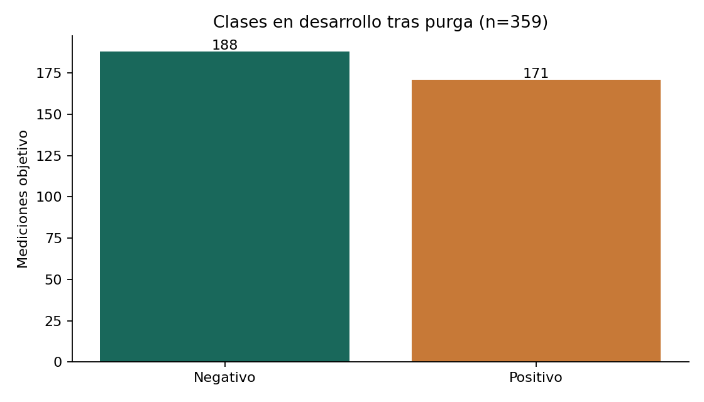
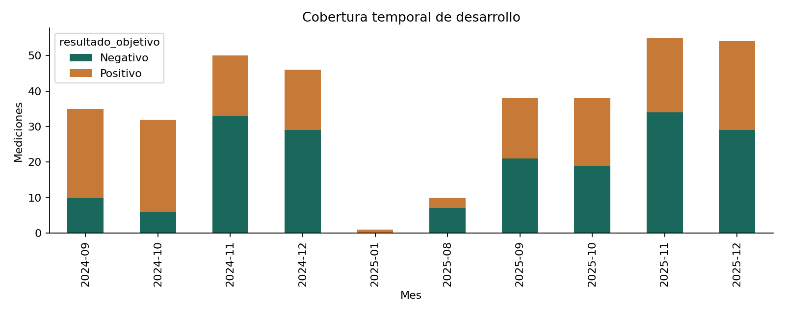
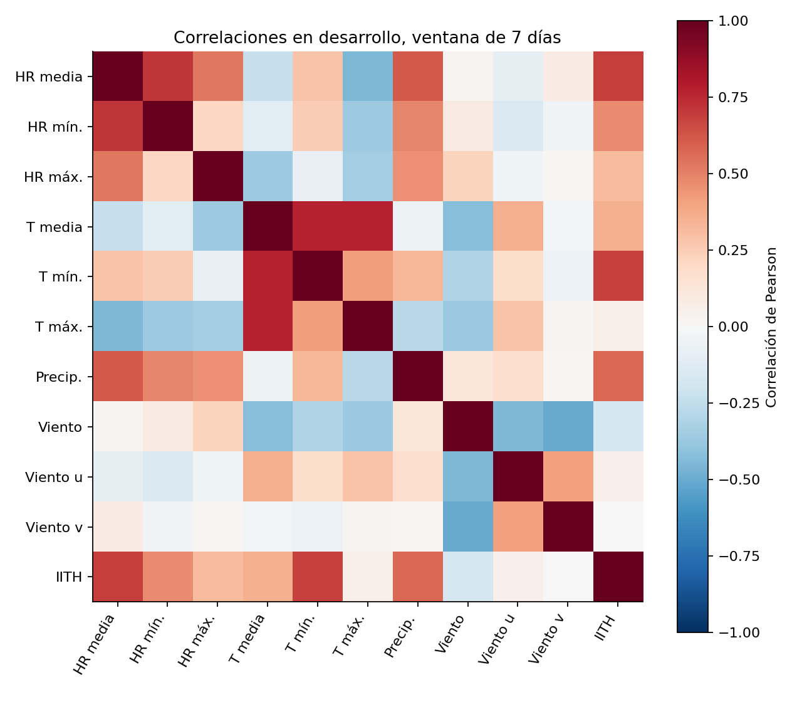
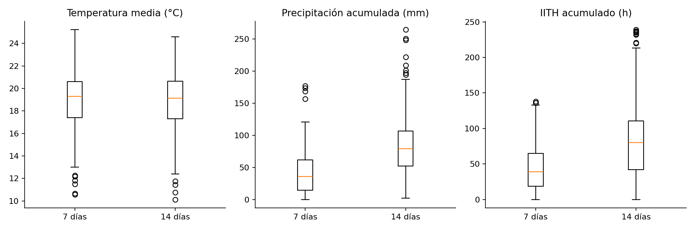
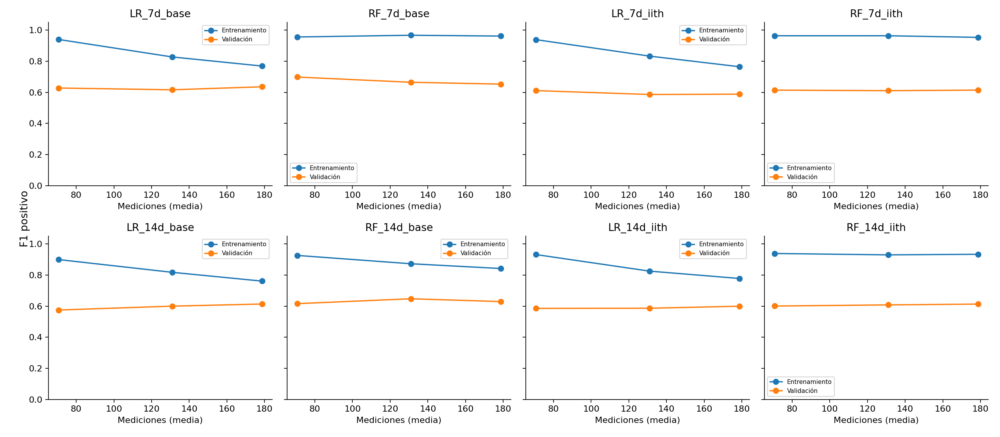
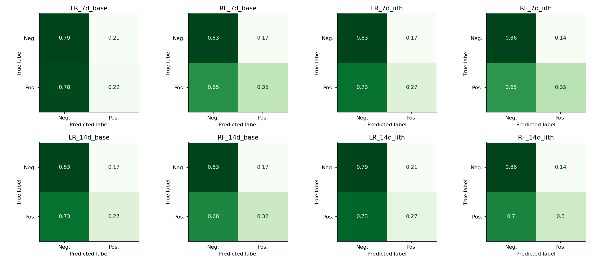
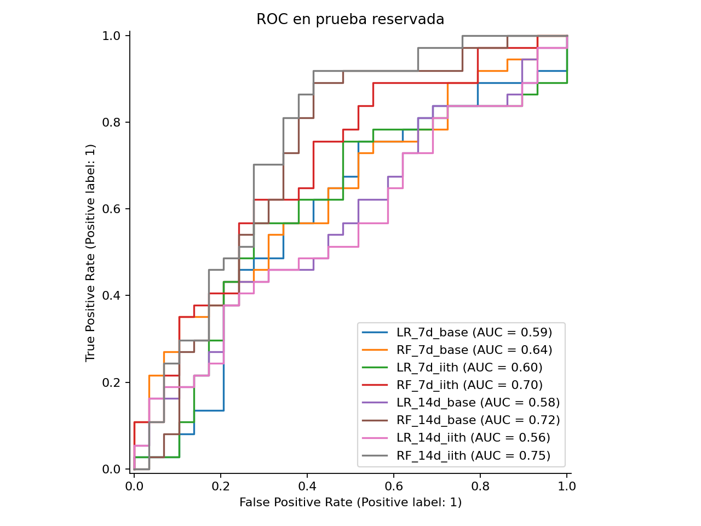
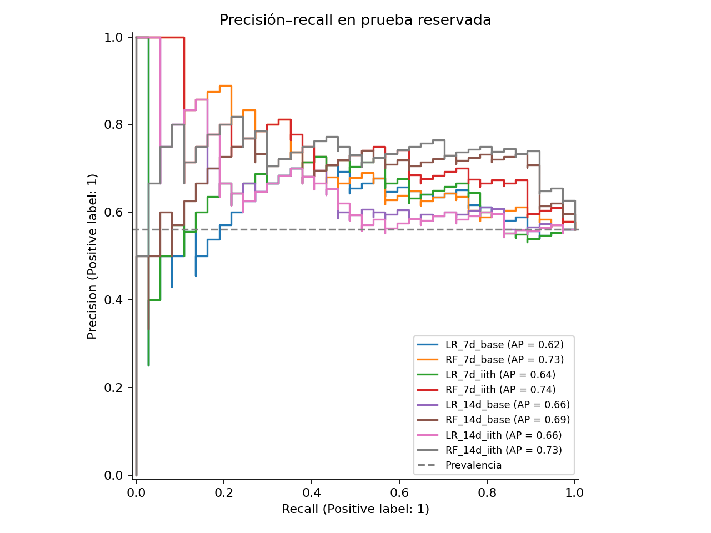

# Predicción de roya de soja con datos climáticos

Machine Learning 1 (23433), FIUNA, Ingeniería Electrónica, 2026.

- Hugo Rene Caniza Portillo — hcaniza@fiuna.edu.py — https://github.com/hugocaniza18
- Ruben Dario Lopez Sanabria — rubenlopez@fiuna.edu.py — [GitHub](https://github.com/Rub3nL0pez)

## Problema, datos y metodología

## Problema y propósito

Estudiar si las condiciones meteorológicas anteriores a una observación permiten clasificar el resultado positivo o negativo publicado por CIRAM. Es una clasificación binaria retrospectiva, útil para evaluar asociaciones y construir una base experimental para investigaciones posteriores.

**Entrada del modelo:** diez resúmenes meteorológicos de los 7 o 14 días completos anteriores a la fecha objetivo, con una variante que agrega IITH (once predictores). **Salida:** puntuación probabilística de resultado positivo y clasificación positiva si es mayor o igual a 0,5. La probabilidad no ha sido calibrada para uso agronómico.

La ubicación y fecha identifican qué registros meteorológicos recuperar, pero no entran al clasificador. El resultado del día objetivo solo sirve como etiqueta de entrenamiento y evaluación. No se usan como entrada su clima, su resultado ni las etiquetas históricas de roya.

## Etiquetas y unidad de observación

El original contiene 650 registros deduplicados por punto y fecha: 211 `Positivo`, 217 `Negativo` y 222 `Não Avaliado`. Se retienen 428 objetivos binarios. Los códigos originales 79, 80 y 82 corresponden respectivamente a esas tres clases. La auditoría comprueba esta correspondencia y ausencia de conflictos. Un identificador `id_medicion` representa un único objetivo, incluso cuando aparece 14 veces en el archivo largo.

La documentación pública de Epagri describe visitas semanales, evaluación de láminas de colectores y observación de síntomas. IFSC describe el monitoreo de esporos publicado en Agroconnect. Esto respalda interpretar los resultados como monitoreo fitosanitario, pero no confirma de forma individual el protocolo y momento de muestreo de cada fila del endpoint. Por ello la salida se denomina **resultado positivo registrado**, sin equipararla a infección clínica, incidencia, severidad ni riesgo futuro. Las fechas de consulta y snapshots tampoco constituyen muestras biológicas independientes. No se conoce la hora de disponibilidad de cada etiqueta.

Fuentes: [Epagri, descripción del monitoreo](https://blog.epagri.sc.gov.br/alertas-emitidos-pela-epagri-ajudam-no-controle-de-doenca-que-pode-dizimar-lavouras-de-soja/), [IFSC, colectores y Agroconnect](https://www.ifsc.edu.br/en/web/noticias/w/campus-canoinhas-reforca-servico-de-monitoramento-da-ferrugem-asiatica-da-soja-no-planalto-norte), [Agroconnect](https://ciram.epagri.sc.gov.br/agroconnect/).

## Meteorología y preprocesamiento

Se consulta ERA5 mediante Open-Meteo, con resolución nominal 0,25°, hora local `America/Sao_Paulo` y viento en m/s. Es reanálisis de una celda y no medición de una estación situada en el punto. Se conserva cada respuesta JSON con URL y SHA-256. Las ventanas contienen exactamente 24 horas por día (00 a 23), d−14 a d−1. Los acumulados de precipitación usan la asignación temporal de la API, cuyas cantidades horarias describen la hora anterior. Excluir d0 no convierte ERA5 en un predictor disponible en tiempo real, pues tiene demora de publicación y asimilación retrospectiva.

Se calculan HR y temperatura media, mínima y máxima; precipitación total; velocidad media del viento y sus componentes vectoriales medias u/v. La dirección se expresa en grados de procedencia, u=−velocidad·sen(dirección), v=−velocidad·cos(dirección). Promediar u/v evita tratar 359° y 1° como direcciones opuestas.

IITH diario = número de horas con HR ≥ 85 % y 15 °C ≤ T ≤ 28 °C, inclusive. Se suma sobre la ventana. Es la definición operativa elegida para este TP, sin afirmar que sea el índice oficial CIRAM ni una regla validada de infección. HMF sigue pendiente y no se reemplaza por horas húmedas. Las horas con HR≥90 % se guardan solo como dato auxiliar.

Se verifica integridad horaria, finitud, HR en [0,100] y precipitación/viento no negativos. Si falta clima se intenta recuperar y, si persiste, se excluye el objetivo de ambas ventanas; no se imputan series. Los extremos meteorológicos válidos se conservan y se describen mediante la regla exploratoria de 1,5 IQR. No se recortan valores según el conjunto de prueba.

La roya histórica se cruza exactamente por coordenadas y fecha: `evaluado`, `no_evaluado` o `sin_registro`. Los dos últimos mantienen vacía la clase binaria. No se arrastra el último valor. Solo son auxiliares.

Las diez variables base son numéricas. No se necesita OneHotEncoder. Regresión logística utiliza StandardScaler ajustado dentro de cada fold. Random Forest recibe las variables sin escalar. Los resúmenes se calculan con precisión completa, sin redondeos intermedios.

## Diseño experimental fijado

Mismas mediciones para 7 y 14 días. Prueba reservada desde 2026-01-01 hasta la última fecha disponible, 2026-03-02. Se excluyen del ajuste los objetivos de los 14 días anteriores a 2026-01-01. Desarrollo efectivo: 359 mediciones; purga: 3; prueba: 66.

Tres validaciones crecientes usan las últimas 21 fechas únicas de desarrollo, en bloques de siete fechas consecutivas **observadas**, no siete días calendario. En cada fold solo se entrenan objetivos con fecha estrictamente anterior al inicio de validación menos 14 días. No se dividen filas diarias ni se mezclan ubicaciones de una misma fecha entre entrenamiento y validación. Se verifican ambas clases. La irregularidad del muestreo hace que el primer bloque abarque diciembre de 2024 a septiembre de 2025.

Ocho configuraciones: LR/RF × 7/14 días × sin/con IITH. LR: C en [0,1; 1; 10], máximo 3.000 iteraciones. RF: 300 árboles, profundidad [3,5,sin límite], mínimo por hoja [3,5,10]. Semilla 42. GridSearchCV usa las particiones guardadas. Se elige el mayor F1 medio de positivos. Empate redondeado a tres decimales: menor ventana, menos predictores, LR. La selección y hashes se escriben antes de evaluar prueba. Todas las configuraciones se reportan en prueba, sin cambiar la seleccionada.

Se reportan precisión, recall, F1, accuracy, balanced accuracy, ROC-AUC y average precision. F1 enfatiza el equilibrio entre detección de positivos y falsas alarmas, pero no fija un costo agronómico. La desviación entre folds describe sensibilidad temporal, no es intervalo de confianza. Las curvas de aprendizaje usan prefijos cronológicos de fechas completas (40 %, 70 % y 100 %) dentro de cada entrenamiento, conservando validación y purga.

## Límites de interpretación

La prueba mide generalización temporal sobre puntos del mismo sistema, no nuevas regiones. La dependencia espacial, celdas compartidas, repetición de ubicaciones, tamaño pequeño, intervalos irregulares y cambios entre campañas limitan la generalización. Diferencias de métricas son descriptivas y no prueban significancia ni causalidad. No se incluyen manejo, variedad, fenología, disponibilidad de hospedantes o tratamientos.

Un modelo climático puede captar estacionalidad asociada al monitoreo. No demuestra que el clima cause los positivos observados. Para una alerta futura serían necesarias nuevas campañas, validación por región, datos disponibles en tiempo real, definición de horizonte y evaluación prospectiva. HMF y meteorología de estaciones CIRAM quedan como ampliaciones.

Documentación meteorológica: [Open-Meteo Historical Weather API](https://open-meteo.com/en/docs/historical-weather-api).

## Auditoría y cobertura

428 objetivos, 211 positivos y 217 negativos, 22 coordenadas y 47 fechas. Correspondencia completa con el original. Las ventanas contienen 5.992 y 2.996 filas, pero cada tabla de aprendizaje tiene 428 muestras. No hubo exclusiones por clima faltante. En 14 días hay 684 antecedentes evaluados, 79 no evaluados y 5.229 sin registro exacto.

## Particiones utilizadas

| fold | entrenamiento | validacion | inicio | fin |
| --- | --- | --- | --- | --- |
| 1 | 133 | 27 | 2024-12-23 | 2025-09-08 |
| 2 | 174 | 62 | 2025-09-15 | 2025-10-27 |
| 3 | 229 | 109 | 2025-11-03 | 2025-12-15 |

Prueba: 66 mediciones (37 positivas y 29 negativas), enero–marzo de 2026. Purga final: 3.

## Análisis exploratorio

Desarrollo después de la purga: 188 negativos y 171 positivos. Las clases son cercanas en tamaño, lo que no garantiza equilibrio por fecha o punto.

Hay registros en diez meses de desarrollo y un intervalo largo sin observaciones. Ausencia de registros no equivale a ausencia de roya.

Los 22 puntos tienen cantidades distintas de observaciones. El tamaño representa frecuencia de monitoreo, no riesgo ni área cultivada.

La mayor correlación absoluta entre predictores de 7 días es entre temperatura media y máxima (r=0.770). Es redundancia meteorológica, no evidencia causal de roya.

Las medianas de precipitación son 35.9 y 79.1 mm. IITH: 39 y 80 h. Los acumulados crecen con la duración de ventana, lo que no demuestra mejor predicción.

## Resultados

| config | cv_f1 | cv_std | test_f1 | test_precision | test_recall | test_accuracy | test_balanced_accuracy | test_roc_auc | test_average_precision |
| --- | --- | --- | --- | --- | --- | --- | --- | --- | --- |
| LR_7d_base | 0.636 | 0.096 | 0.314 | 0.571 | 0.216 | 0.470 | 0.505 | 0.592 | 0.624 |
| RF_7d_base | 0.653 | 0.097 | 0.473 | 0.722 | 0.351 | 0.561 | 0.589 | 0.642 | 0.726 |
| LR_7d_iith | 0.588 | 0.066 | 0.385 | 0.667 | 0.270 | 0.515 | 0.549 | 0.603 | 0.641 |
| RF_7d_iith | 0.614 | 0.114 | 0.481 | 0.765 | 0.351 | 0.576 | 0.607 | 0.701 | 0.743 |
| LR_14d_base | 0.614 | 0.044 | 0.385 | 0.667 | 0.270 | 0.515 | 0.549 | 0.575 | 0.660 |
| RF_14d_base | 0.629 | 0.052 | 0.444 | 0.706 | 0.324 | 0.545 | 0.576 | 0.716 | 0.689 |
| LR_14d_iith | 0.599 | 0.064 | 0.377 | 0.625 | 0.270 | 0.500 | 0.532 | 0.561 | 0.656 |
| RF_14d_iith | 0.613 | 0.076 | 0.423 | 0.733 | 0.297 | 0.545 | 0.580 | 0.753 | 0.732 |

F1, precisión y recall se refieren a la clase positiva. La dispersión CV corresponde a tres bloques temporales.

### Efecto de la ventana

| modelo | IITH | delta_F1_CV_14_menos_7 | delta_F1_prueba_14_menos_7 |
| --- | --- | --- | --- |
| LR | False | -0.022 | 0.0709 |
| LR | True | 0.0111 | -0.0073 |
| RF | False | -0.0234 | -0.0283 |
| RF | True | -0.0012 | -0.0584 |

Promedios de tres folds con prefijos de fechas completas. El eje horizontal es el tamaño medio de entrenamiento. Son diagnósticos de desarrollo, no una estimación independiente del rendimiento seleccionado.

Filas normalizadas por clase real. El modelo seleccionado reconoce el 35,1 % de positivos y el 82,8 % de negativos; la sensibilidad a positivos es limitada.

La ROC compara sensibilidad y falsas alarmas al variar el umbral. No se utilizó para cambiar el umbral fijado en 0,5.

La curva precisión–recall centra la atención en positivos. La línea horizontal es la prevalencia en prueba (37/66), no un modelo adicional entrenado.

## Conclusiones

La selección por validación fue RF_7d_base, con F1 medio 0.653 y desviación entre bloques 0.097.

En prueba, su F1 fue 0.473, precisión 0.722 y recall 0.351. Detectó 13 de los 37 positivos y omitió 24. Clasificó correctamente 24 de los 29 negativos.

Ampliar a 14 días no mostró una mejora consistente: el F1 de validación bajó en tres de cuatro comparaciones equivalentes. En prueba mejoró solo LR sin IITH. Son diferencias descriptivas, sin evidencia de significancia estadística.

RF con 7 días e IITH logró el mayor F1 de prueba (0,481), pero no reemplaza al modelo seleccionado previamente. RF con 14 días e IITH logró el mayor ROC-AUC (0,753): el ordenamiento de probabilidades y el F1 con umbral 0,5 miden propiedades diferentes.

Agregar IITH no mejoró F1 de validación en ninguna comparación equivalente. Su utilidad futura no queda descartada por este conjunto pequeño.

La caída entre validación y prueba señala generalización temporal limitada. Las curvas de aprendizaje muestran diferencias entre ajuste y validación, compatibles con sobreajuste y cambios de distribución. No permiten separar sus causas.

## Trabajo futuro y entrega

Validar nuevas campañas y regiones; confirmar protocolo de etiqueta y disponibilidad temporal; incorporar HMF, estaciones y contexto agronómico. Explorar calibración y umbrales en un nuevo desarrollo, conservando una prueba futura intacta.

La versión local incluye datos, modelos y portal. La edición pública ofrece métricas agregadas y ejemplos sin identificadores de origen. La redistribución de las etiquetas requiere aclarar las condiciones de CIRAM. Ver `docs/FUENTES_Y_LICENCIAS.md`.
