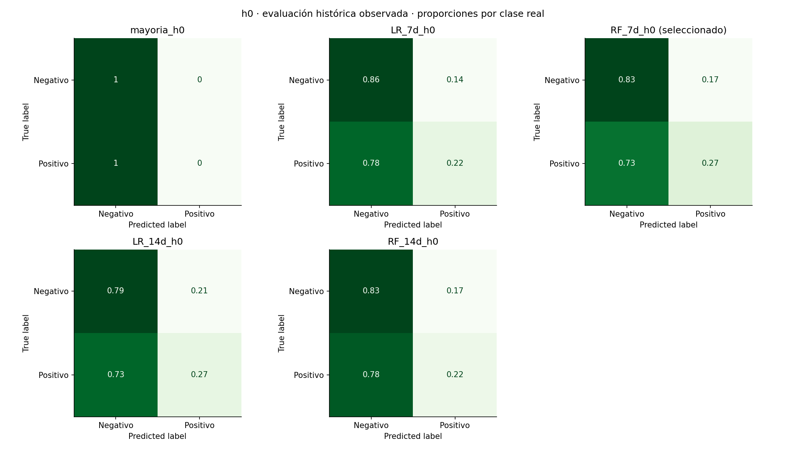
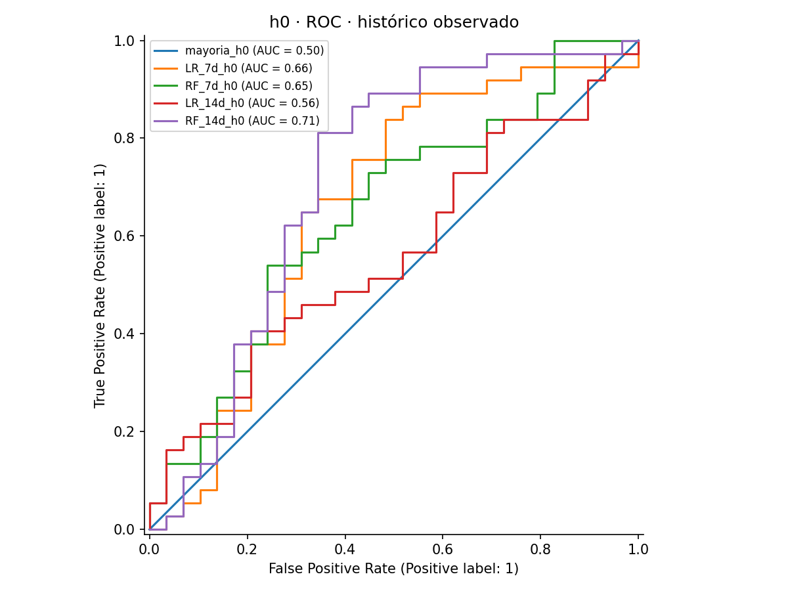
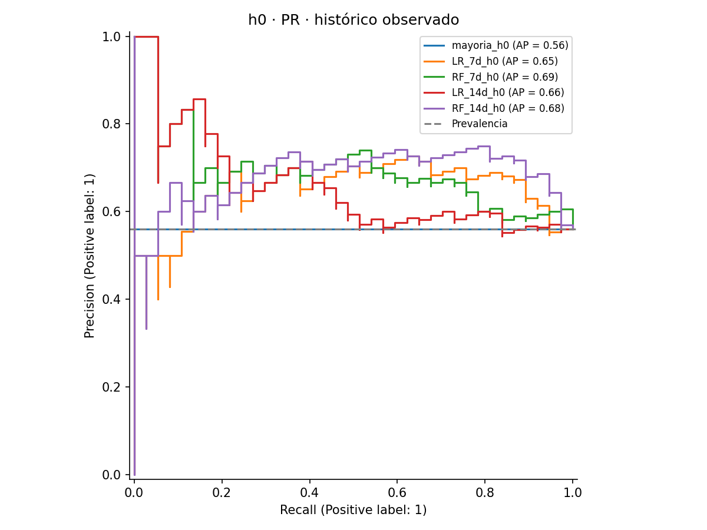
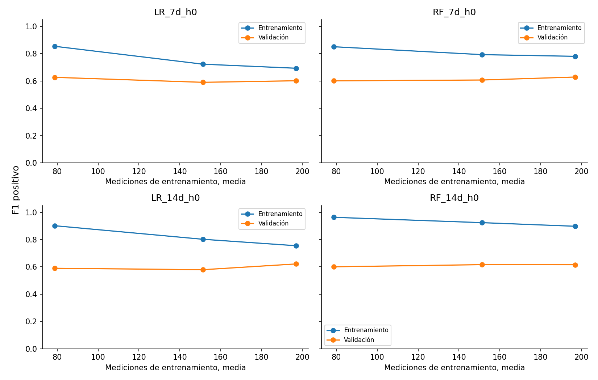
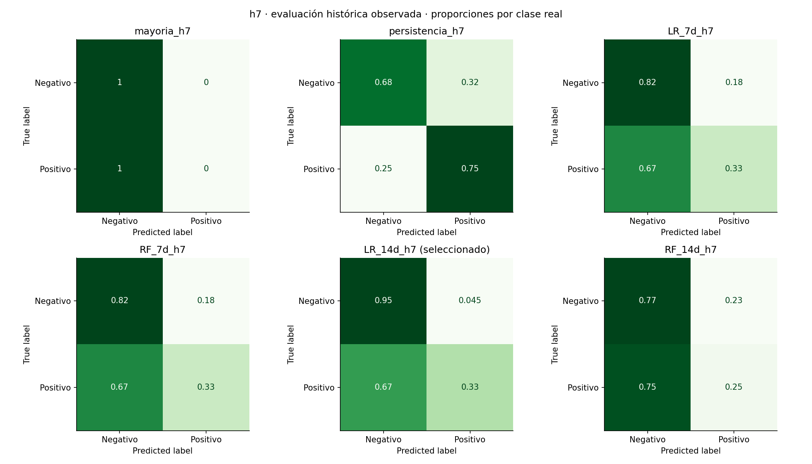
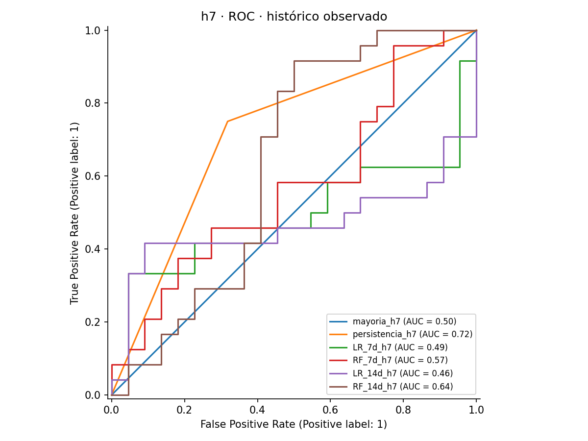
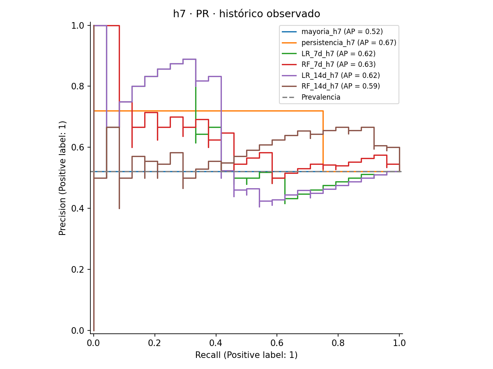
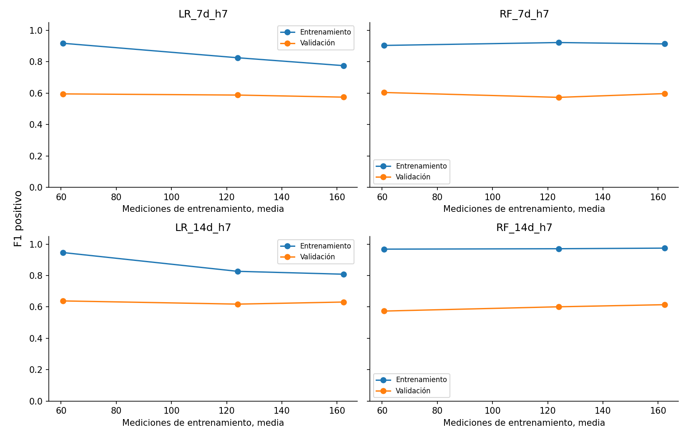

# Experimentos definitivos de la Etapa D

Machine Learning 1, FIUNA. Hugo Rene Caniza Portillo y Ruben Dario Lopez Sanabria.

## Diseño experimental

Evaluamos dos horizontes, h0 y h7, con ventanas meteorológicas de 7 y 14 días. Utilizamos exclusivamente horizontes_v2_c02, diez predictores y las particiones aprobadas. LR incluye StandardScaler dentro del pipeline. RF utiliza 300 árboles. Mantuvimos semilla 42 y umbral 0,5.

Las entradas son HR media/mínima/máxima, temperatura media/mínima/máxima, precipitación acumulada, velocidad media del viento y componentes u/v. Se excluye IITH. El estado actual solo se utiliza para la referencia de persistencia h7.

GridSearchCV ajustó LR con C en {0,1; 1; 10} y RF con profundidad {3,5,sin límite} y mínimo por hoja {3,5,10}. Usamos tres validaciones crecientes de seis fechas semanales de etiqueta y la purga aprobada respecto de referencias. Seleccionamos por F1 positivo medio dentro de cada horizonte. Los empates redondeados a tres decimales favorecen 7 días y luego LR.

La mayoría se ajusta solo con entrenamiento y elige negativo en empate. Su puntuación es la prevalencia de entrenamiento. Persistencia usa y(t) como clase y puntuación binaria para h7. Las referencias se evalúan una vez por población y partición.

## Poblaciones y evaluación

H0 comprende 428 muestras, con 359 en desarrollo, 3 en purga y 66 en evaluación histórica (29 negativas, 37 positivas). H7 comprende 362, con 313 en desarrollo, 3 en purga y 46 históricas (22 negativas, 24 positivas). Las dos ventanas comparten muestras dentro de cada horizonte.

Las validaciones tienen etiquetas 18/08–22/09/2025, 29/09–03/11/2025 y 10/11–15/12/2025. En h7, las referencias son siete días anteriores. Los tamaños entrenamiento/validación son h0: 164/38, 188/55 y 239/100; h7: 141/31, 150/51 y 196/90. El primer bloque evalúa transferencia desde datos de la campaña anterior.

Enero–marzo de 2026 es una evaluación histórica previamente observada. Conservamos las particiones y la selección de desarrollo. Esta evaluación no constituye una prueba inédita. El historial anterior de experimentos se considera exposición previa, no una fuente para ajustar parámetros en esta ejecución.

## Resultados comparativos

F1, precisión y recall corresponden a la clase positiva. DE es la desviación estándar poblacional entre tres folds, descriptiva. CV participó en ajuste y selección, por lo que su resultado tampoco es una evaluación independiente.

| config | seleccionado | cv_f1 | cv_std | historico_f1 | historico_precision | historico_recall | historico_accuracy | historico_balanced_accuracy | historico_roc_auc | historico_average_precision |
| --- | --- | --- | --- | --- | --- | --- | --- | --- | --- | --- |
| LR_14d_h0 | False | 0.622 | 0.026 | 0.377 | 0.625 | 0.270 | 0.500 | 0.532 | 0.565 | 0.659 |
| LR_14d_h7 | True | 0.631 | 0.054 | 0.485 | 0.889 | 0.333 | 0.630 | 0.644 | 0.464 | 0.622 |
| LR_7d_h0 | False | 0.602 | 0.072 | 0.327 | 0.667 | 0.216 | 0.500 | 0.539 | 0.661 | 0.648 |
| LR_7d_h7 | False | 0.574 | 0.083 | 0.444 | 0.667 | 0.333 | 0.565 | 0.576 | 0.489 | 0.621 |
| RF_14d_h0 | False | 0.616 | 0.057 | 0.320 | 0.615 | 0.216 | 0.485 | 0.522 | 0.715 | 0.682 |
| RF_14d_h7 | False | 0.614 | 0.066 | 0.343 | 0.545 | 0.250 | 0.500 | 0.511 | 0.636 | 0.593 |
| RF_7d_h0 | True | 0.629 | 0.102 | 0.385 | 0.667 | 0.270 | 0.515 | 0.549 | 0.649 | 0.695 |
| RF_7d_h7 | False | 0.597 | 0.096 | 0.444 | 0.667 | 0.333 | 0.565 | 0.576 | 0.574 | 0.635 |
| mayoria_h0 | False | 0.189 | 0.267 | 0.000 | 0.000 | 0.000 | 0.439 | 0.500 | 0.500 | 0.561 |
| mayoria_h7 | False | 0.613 | 0.048 | 0.000 | 0.000 | 0.000 | 0.478 | 0.500 | 0.500 | 0.522 |
| persistencia_h7 | False | 0.518 | 0.261 | 0.735 | 0.720 | 0.750 | 0.717 | 0.716 | 0.716 | 0.670 |

## Modelos seleccionados exclusivamente en validación

Para h0 seleccionamos **RF_7d_h0**, parámetros {'model__max_depth': 3, 'model__min_samples_leaf': 10}, F1 CV 0.629 ± 0.102. En histórico obtuvo F1 0.385, precisión 0.667, recall 0.270, ROC-AUC 0.649 y AP 0.695. Reconoció 10 positivos y omitió 27.

Para h7 seleccionamos **LR_14d_h7**, parámetros {'model__C': 10}, F1 CV 0.631 ± 0.054. En histórico obtuvo F1 0.485, precisión 0.889, recall 0.333, ROC-AUC 0.464 y AP 0.622. Reconoció 8 positivos y omitió 16.

## Interpretación

En h0, RF de 7 días supera ligeramente a LR de 14 días en F1 de validación; el modelo elegido alcanza F1 histórico 0,385 y reconoce 10 de 37 positivos. La referencia mayoritaria elige negativo en desarrollo y tiene F1 positivo histórico cero. Superarla no establece utilidad agronómica.

En h7, LR de 14 días alcanza F1 histórico 0,485 y reconoce 8 de 24 positivos. Persistencia obtiene F1 0,735, recall 0,750 y accuracy 0,717, frente a 0,630 de accuracy del modelo climático elegido. La comparación favorece la referencia en ese período histórico. Persistencia utiliza estado actual, por lo que tiene información diferente de los clasificadores meteorológicos.

La mayoría h7 tiene F1 medio de validación 0,613 y F1 histórico cero. El cambio de clase mayoritaria entre entrenamientos muestra por qué accuracy o un F1 medio aislado requieren examinar cada fold. Las predicciones de mayoría en empate se evalúan según la regla de clase 0, aunque la puntuación sea 0,5.

Extender la ventana favorece a LR en F1 de validación en ambos horizontes, mientras RF obtiene mayor F1 con 7 días. No aparece una mejora uniforme para todos los algoritmos. Los deltas completos se incluyen en diferencias_descriptivas.csv. Estos resultados son descriptivos y no prueban significancia estadística.

El ROC-AUC histórico 0,464 de LR de 14 días h7 advierte que su ordenamiento global de puntuaciones es débil en esa población, aunque a umbral 0,5 sus nueve positivos predichos incluyan ocho aciertos. No ajustamos el umbral ni calibramos probabilidades después de observar este comportamiento.

## Curvas y matrices

Las matrices se normalizan por clase real; sus conteos se guardan en CSV. ROC y PR utilizan las puntuaciones originales. Las curvas de las referencias corresponden a puntuaciones constantes o binarias. La línea de prevalencia en PR describe la proporción positiva de la evaluación.

Las curvas de aprendizaje usan prefijos cronológicos de fechas completas al 40 %, 70 % y 100 % del entrenamiento de cada fold, con hiperparámetros ya elegidos. Los puntos representan promedios de bloques. Son diagnósticos de desarrollo y no modificaron la selección.

## Limitaciones y conclusiones

La etiqueta representa el resultado registrado. fecha_registro coincide con primera_consulta en los originales y no acredita fecha de muestreo. Faltan datos de publicación para confirmar que cada etiqueta estaba disponible al emitir una predicción. El origen específico de cada positivo —esporos, síntomas o persistencia— sigue pendiente de confirmación.

ERA5 es retrospectivo y su disponibilidad operacional no está acreditada. Las ubicaciones se repiten, algunas comparten celdas y la identidad física de Jupiá conserva incertidumbre. La cobertura por ubicación y campaña es desigual. H0 y h7 usan poblaciones distintas. Las asociaciones y las diferencias observadas no demuestran causalidad ni generalización a nuevas regiones.

En este diseño los modelos climáticos seleccionados muestran recall limitado. Para +7, persistencia supera al modelo climático seleccionado en la evaluación histórica. El trabajo conserva su carácter experimental y no respalda una alerta agronómica validada. Las próximas investigaciones requerirían fechas de disponibilidad verificadas y una evaluación prospectiva inédita definida antes de analizar resultados.

## Reproducibilidad y verificación

Verificamos 44 registros de métricas, 2603 predicciones y ocho modelos recargados. Error máximo de puntuaciones recargadas: 8.33e-17. Dos ejecuciones completas coincidieron en selección, métricas y probabilidades con tolerancia absoluta 10⁻¹². La selección congelada precede a la evaluación histórica y mantiene el mismo hash.

Los hashes de entradas, configuración, código y selección se conservan en los manifiestos. entorno.json identifica versiones y commit base; los scripts de esta etapa todavía no confirmados se identifican por SHA-256, para evitar atribuirlos al commit anterior.

Los modelos y predicciones por muestra permanecen en work/etapa_d/run01, excluido de Git. El reporte agregado conserva las cifras y figuras revisables. Para reproducir el experimento se necesitan los insumos locales autorizados. Las etiquetas Epagri tienen condiciones de redistribución pendientes de aclaración. Datos meteorológicos de Open-Meteo/ERA5, CC BY 4.0, agregados por el equipo.

La ejecución utiliza scripts/experimentos_etapa_d.py, scripts/verificar_experimentos_d.py y scripts/reportar_etapa_d.py, con config/etapa_d.json. Los notebooks finales, presentación y portal corresponden a una etapa posterior.
