## 1. Identificación académica

**Roya de soja y clima**

Machine Learning 1 (23433) · Ingeniería Electrónica · FIUNA, Universidad Nacional de Asunción · 2026.

Hugo Rene Caniza Portillo · hcaniza@fiuna.edu.py · [GitHub](https://github.com/hugocaniza18)

Ruben Dario Lopez Sanabria · rubenlopez@fiuna.edu.py · [GitHub](https://github.com/Rub3nL0pez)

[Repositorio del proyecto](https://github.com/hugocaniza18/ml1-proyecto-final)

Evaluamos dos horizontes y dos ventanas meteorológicas mediante clasificación binaria. El estudio es retrospectivo y no constituye una alerta agronómica validada.

## 2. Problema y objetivos

La identificación del estado sanitario de la soja requiere seguimiento. Estudiamos si resúmenes de humedad, temperatura, lluvia y viento permiten discriminar el resultado registrado de roya asiática. No inferimos causalidad ni sustituimos una evaluación de campo.

Nuestro objetivo general es evaluar esa capacidad predictiva bajo separación temporal. Los objetivos específicos son auditar las etiquetas, comparar ventanas de 7 y 14 días, contrastar regresión logística y Random Forest y evaluar referencias sencillas de mayoría y persistencia.

**Entrada:** diez variables meteorológicas de t−7 a t−1 o de t−14 a t−1. **Salida h0:** estado registrado en t. **Salida h7:** estado registrado exactamente en t+7. H7 incluye positivos previos y no identifica exclusivamente primeras detecciones. Comparamos aprendizaje con referencias para comprobar si aporta valor frente a reglas sencillas.

La roya asiática es causada por *Phakopsora pachyrhizi*. La temperatura y la humedad sobre la superficie foliar intervienen en la infección, mientras la meteorología también afecta dispersión y desarrollo epidémico (Del Ponte y Esker, 2008; Melching et al., 1989). Esto motiva estudiar variables climáticas, sin equiparar humedad relativa con mojado foliar ni extrapolar resultados controlados directamente a una alerta de campo.

## 3. Datos y exploración

### 3.1 Fuentes, integridad y unidad de observación

Las etiquetas provienen de [Epagri/CIRAM Agroconnect](https://ciram.epagri.sc.gov.br/agroconnect/), a través del endpoint `busca-doenca-munic.jsp`. La meteorología procede de respuestas horarias **Open-Meteo/ERA5**, con horario local `America/Sao_Paulo` (UTC−3). Los datos meteorológicos requieren atribución [CC BY 4.0](https://creativecommons.org/licenses/by/4.0/); las condiciones de redistribución de las etiquetas siguen pendientes de aclaración. Conservamos los datos individuales localmente y mostramos agregados revisables.

Una observación es un resultado registrado para una ubicación y fecha. Los snapshots repetidos ya fueron deduplicados en la fuente recibida. Una muestra experimental agrega una ventana meteorológica; sus 7 o 14 días **no son muestras independientes**.

Los tipos recibidos describen el CSV, no el tipo conceptual de cada variable. La presencia de una fecha legible o de valores completos no acredita la fecha de muestreo ni el significado de campos sin documentación. Conservamos esas limitaciones y no usamos los campos auxiliares como predictores.

`fecha_registro` coincide con `primera_consulta` en los 650 registros. Por eso la interpretamos como fecha del resultado registrado/observado en la reconstrucción, **no como fecha de muestreo comprobada**. Hay 23 IDs de punto y 22 ubicaciones por coordenadas; la correspondencia física de los puntos con coordenadas compartidas conserva incertidumbre. La normalización técnica no elimina esa incertidumbre.

### 3.2 Etiquetas y clases

El endpoint codifica **79 → Positivo**, **80 → Negativo** y **82 → Não Avaliado**. En los modelos usamos 1 y 0 para los dos primeros estados. `Não Avaliado` significa ausencia de una evaluación utilizable y nunca se convierte en negativo. Un positivo registrado no permite distinguir por sí solo una infección nueva, una primera detección o un positivo posterior.

<table border="1" class="dataframe">
  <thead>
    <tr style="text-align: right;">
      <th>clase_codigo</th>
      <th>clase_original</th>
      <th>n</th>
      <th>porcentaje</th>
    </tr>
  </thead>
  <tbody>
    <tr>
      <td>79</td>
      <td>Positivo</td>
      <td>211</td>
      <td>32.460</td>
    </tr>
    <tr>
      <td>80</td>
      <td>Negativo</td>
      <td>217</td>
      <td>33.380</td>
    </tr>
    <tr>
      <td>82</td>
      <td>Não Avaliado</td>
      <td>222</td>
      <td>34.150</td>
    </tr>
  </tbody>
</table>

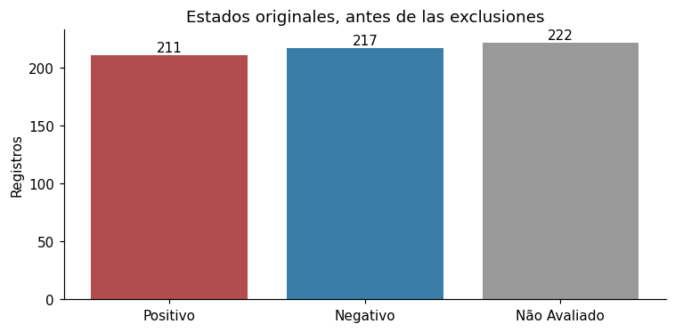

*Etiquetas y clases. Resultados oficiales del notebook académico.*

El original contiene 211 positivos, 217 negativos y 222 no evaluados. La cercanía entre positivos y negativos globales no garantiza el mismo balance por fecha, ubicación o partición. Esta auditoría general describe la fuente; las decisiones exploratorias se limitan al desarrollo en el segundo notebook. El protocolo concreto de confirmación agronómica de cada positivo sigue sin estar acreditado.

### 3.3 Variables meteorológicas y cobertura

Los diarios contienen 24 horas válidas por día local. Agregamos medias, mínimos, máximos y precipitación acumulada según la tabla siguiente. Las componentes del viento usan dirección meteorológica de procedencia: $u=-v\,\sin(\theta)$ y $v_{N}=-v\,\cos(\theta)$. La velocidad y sus componentes se expresan en m/s; una componente negativa indica sentido, no un error.

<table border="1" class="dataframe">
  <thead>
    <tr style="text-align: right;">
      <th>variable</th>
      <th>unidad</th>
      <th>agregación_ventana</th>
    </tr>
  </thead>
  <tbody>
    <tr>
      <td>hr_media_pct</td>
      <td>%</td>
      <td>mean</td>
    </tr>
    <tr>
      <td>hr_min_pct</td>
      <td>%</td>
      <td>min</td>
    </tr>
    <tr>
      <td>hr_max_pct</td>
      <td>%</td>
      <td>max</td>
    </tr>
    <tr>
      <td>temperatura_media_c</td>
      <td>°C</td>
      <td>mean</td>
    </tr>
    <tr>
      <td>temperatura_min_c</td>
      <td>°C</td>
      <td>min</td>
    </tr>
    <tr>
      <td>temperatura_max_c</td>
      <td>°C</td>
      <td>max</td>
    </tr>
    <tr>
      <td>precipitacion_mm</td>
      <td>mm</td>
      <td>sum</td>
    </tr>
    <tr>
      <td>viento_vel_media_10m_ms</td>
      <td>m/s</td>
      <td>mean</td>
    </tr>
    <tr>
      <td>viento_u_media_10m_ms</td>
      <td>m/s</td>
      <td>mean</td>
    </tr>
    <tr>
      <td>viento_v_media_10m_ms</td>
      <td>m/s</td>
      <td>mean</td>
    </tr>
  </tbody>
</table>

<table border="1" class="dataframe">
  <thead>
    <tr style="text-align: right;">
      <th>cobertura</th>
    </tr>
  </thead>
  <tbody>
    <tr>
      <td>428</td>
    </tr>
    <tr>
      <td>5992</td>
    </tr>
    <tr>
      <td>0</td>
    </tr>
    <tr>
      <td>10</td>
    </tr>
    <tr>
      <td>1</td>
    </tr>
    <tr>
      <td>14</td>
    </tr>
  </tbody>
</table>

Las 428 mediciones con meteorología aportan 5.992 filas diarias completas. Las ventanas terminan en t−1: el clima de t y los días entre t y t+7 no entran en los predictores. ERA5 es un reanálisis espacial retrospectivo y no una medición meteorológica de la parcela. Las horas de mojado foliar no forman parte de estos experimentos.

La construcción oficial conserva 428 muestras h0 y 362 h7, cada una representada con dos ventanas. Las 1.580 filas experimentales no equivalen a 1.580 objetivos independientes. H0 y h7 tienen poblaciones diferentes; compararlos directamente como si fueran la misma tarea ocultaría el efecto de las exclusiones.

### 3.4 Exclusiones y alcance del horizonte futuro

Presentamos los motivos por horizonte, contando una exclusión por observación y horizonte, no por ventana. El subconjunto h7 que parte de un negativo es auxiliar; no reemplaza la población oficial ni representa un experimento nuevo.

<table border="1" class="dataframe">
  <thead>
    <tr style="text-align: right;">
      <th></th>
      <th></th>
      <th>exclusiones</th>
    </tr>
    <tr>
      <th>horizonte_dias</th>
      <th>motivo</th>
      <th></th>
    </tr>
  </thead>
  <tbody>
    <tr>
      <th>0</th>
      <th>referencia_no_evaluado</th>
      <td>222</td>
    </tr>
    <tr>
      <th rowspan="3" valign="top">7</th>
      <th>objetivo_no_evaluado</th>
      <td>56</td>
    </tr>
    <tr>
      <th>objetivo_sin_registro</th>
      <td>10</td>
    </tr>
    <tr>
      <th>referencia_no_evaluado</th>
      <td>222</td>
    </tr>
  </tbody>
</table>

<table border="1" class="dataframe">
  <thead>
    <tr style="text-align: right;">
      <th>población</th>
      <th>n</th>
      <th>negativos_en_t_mas_7</th>
      <th>positivos_en_t_mas_7</th>
    </tr>
  </thead>
  <tbody>
    <tr>
      <td>h7 completo</td>
      <td>362</td>
      <td>179</td>
      <td>183</td>
    </tr>
    <tr>
      <td>h7 auxiliar desde negativo</td>
      <td>188</td>
      <td>131</td>
      <td>57</td>
    </tr>
  </tbody>
</table>

En h0 se excluyen 222 referencias no evaluadas. En h7 se suman 56 objetivos no evaluados y 10 sin registro exacto, además de las 222 referencias no evaluadas. La ausencia de visita no indica ausencia de roya. H7 completo incluye positivos en t: predice el estado registrado futuro, no exclusivamente la aparición desde un estado negativo ni una primera infección.

Desarrollo contiene 359 muestras h0 y 313 h7. Las ventanas de 7 y 14 días comparten los mismos objetivos dentro de cada horizonte. Estas cantidades, y no los tamaños históricos, son la base de todas las estadísticas siguientes.

### 3.5 Balance de clases

Comparamos las clases una sola vez por horizonte. El balance agregado puede ocultar cambios entre fechas y ubicaciones, por lo que lo acompañamos después con un análisis de cobertura.

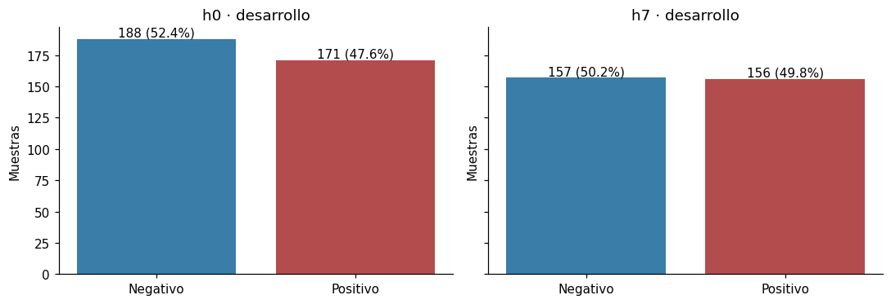

*Balance de clases. Resultados oficiales del notebook académico.*

En h0 hay 188 negativos y 171 positivos; en h7, 157 negativos y 156 positivos. El balance cambia entre horizontes porque h7 exige seguimiento exacto. La clase mayoritaria se calcula con cada entrenamiento, nunca con el bloque validado, aunque el balance global resulte cercano.

### 3.6 Histogramas: comparación de ventanas

Superponemos histogramas de densidad de 7 y 14 días con los mismos intervalos dentro de cada variable y horizonte. La densidad facilita comparar formas; no representa probabilidades de infección. Cada panel conserva su unidad y no mezclamos h0 con h7.

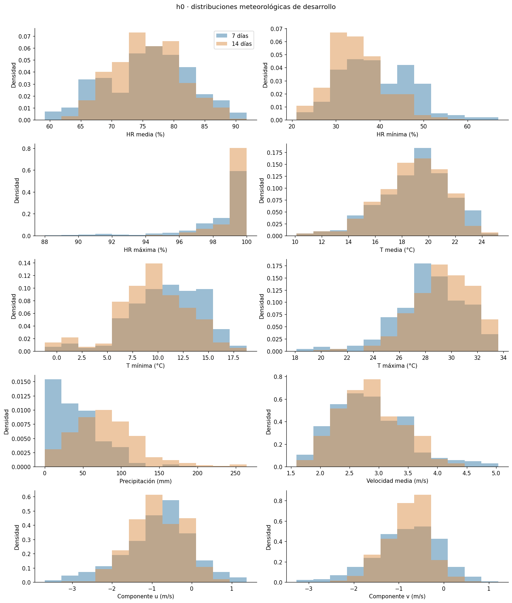

*Histogramas: comparación de ventanas. Resultados oficiales del notebook académico.*

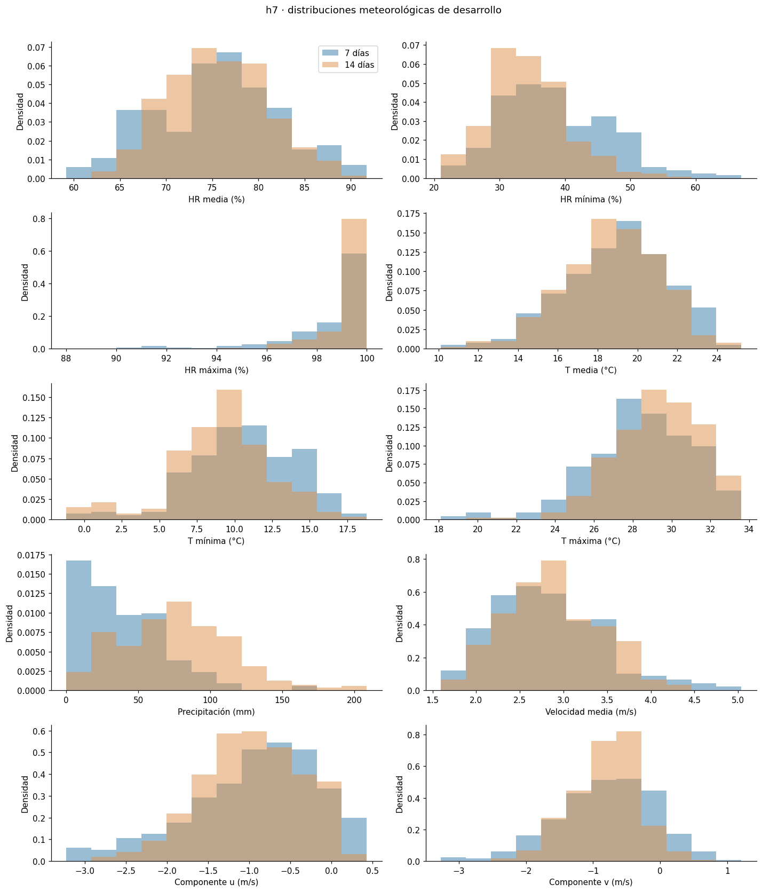

*Histogramas: comparación de ventanas. Resultados oficiales del notebook académico.*

<table border="1" class="dataframe">
  <thead>
    <tr style="text-align: right;">
      <th>horizonte</th>
      <th>ventana</th>
      <th>mediana_lluvia_mm</th>
      <th>p95_lluvia_mm</th>
      <th>máximo_lluvia_mm</th>
    </tr>
  </thead>
  <tbody>
    <tr>
      <td>0</td>
      <td>7</td>
      <td>35.900</td>
      <td>99.110</td>
      <td>176.600</td>
    </tr>
    <tr>
      <td>0</td>
      <td>14</td>
      <td>79.100</td>
      <td>159.730</td>
      <td>264.200</td>
    </tr>
    <tr>
      <td>7</td>
      <td>7</td>
      <td>33.100</td>
      <td>95.840</td>
      <td>173.600</td>
    </tr>
    <tr>
      <td>7</td>
      <td>14</td>
      <td>76.600</td>
      <td>137.100</td>
      <td>208.600</td>
    </tr>
  </tbody>
</table>

La lluvia acumulada presenta una cola derecha que la mediana y el percentil 95 ayudan a describir. Extender la ventana puede aumentar acumulados y ampliar extremos por construcción, sin que ello implique mayor riesgo. Para medias, una ventana más larga puede suavizar variaciones. Los histogramas describen estos cambios; no justifican por sí solos elegir una ventana.

### 3.7 Boxplots por clase y ventana

Comparamos mediana, rango intercuartílico y observaciones extremas de las diez variables. Cada panel muestra cuatro grupos: negativo/positivo de 7 días y negativo/positivo de 14 días. Los puntos fuera de los bigotes son observaciones, no errores confirmados.

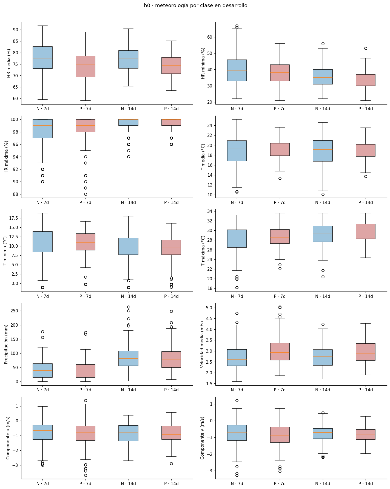

*Boxplots por clase y ventana. Resultados oficiales del notebook académico.*

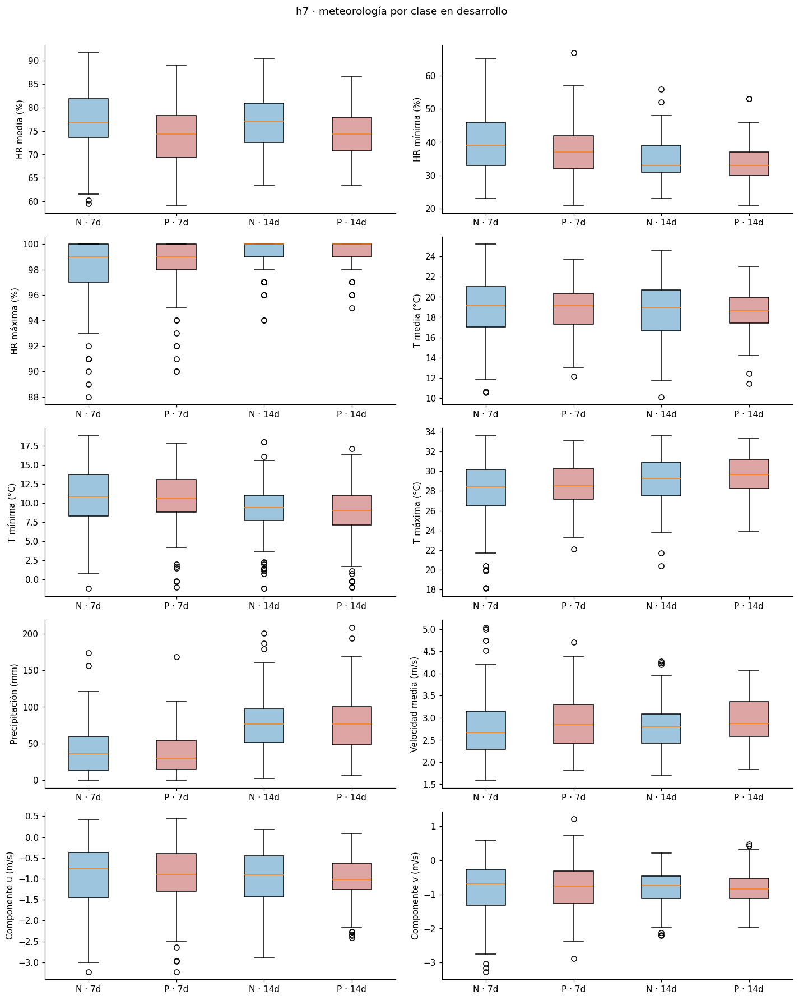

*Boxplots por clase y ventana. Resultados oficiales del notebook académico.*

Los rangos por clase se superponen en múltiples variables: no observamos una separación perfecta mediante un único resumen meteorológico. Las diferencias de mediana no demuestran causalidad ni un umbral agronómico. Además, las observaciones de una ubicación se repiten en el tiempo, por lo que no interpretamos estos boxplots como comparaciones entre muestras independientes.

### 3.8 Correlaciones entre predictores

Calculamos Pearson dentro de desarrollo, por horizonte y ventana. Excluimos identificadores, coordenadas y etiquetas de las matrices. Las correlaciones describen relaciones lineales y no capturan todas las dependencias posibles.

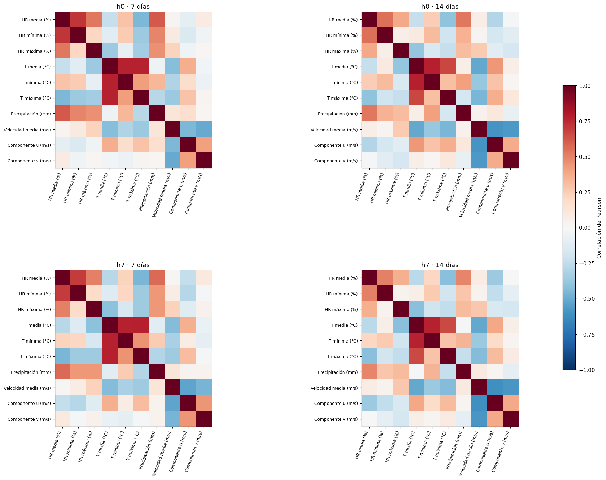

*Correlaciones entre predictores. Resultados oficiales del notebook académico.*

<table border="1" class="dataframe">
  <thead>
    <tr style="text-align: right;">
      <th>horizonte</th>
      <th>ventana</th>
      <th>variable_1</th>
      <th>variable_2</th>
      <th>r</th>
    </tr>
  </thead>
  <tbody>
    <tr>
      <td>0</td>
      <td>7</td>
      <td>temperatura_media_c</td>
      <td>temperatura_max_c</td>
      <td>0.770</td>
    </tr>
    <tr>
      <td>0</td>
      <td>14</td>
      <td>temperatura_media_c</td>
      <td>temperatura_min_c</td>
      <td>0.781</td>
    </tr>
    <tr>
      <td>7</td>
      <td>7</td>
      <td>temperatura_media_c</td>
      <td>temperatura_max_c</td>
      <td>0.778</td>
    </tr>
    <tr>
      <td>7</td>
      <td>14</td>
      <td>temperatura_media_c</td>
      <td>temperatura_min_c</td>
      <td>0.771</td>
    </tr>
  </tbody>
</table>

Las correlaciones más altas de la tabla revelan redundancia entre resúmenes de las mismas familias meteorológicas. No eliminamos variables después de observarlas: mantenemos el contrato de diez predictores del experimento aprobado. Una correlación alta tampoco garantiza utilidad predictiva; esa evaluación corresponde a los folds temporales.

### 3.9 Cobertura temporal y frecuencia de positivos

Contamos muestras por fecha de etiqueta y calculamos la proporción positiva observada. Dibujamos puntos, sin interpolar resultados entre fechas ni atravesar intervalos sin seguimiento. Una fecha sin registros no equivale a una fecha sin roya.

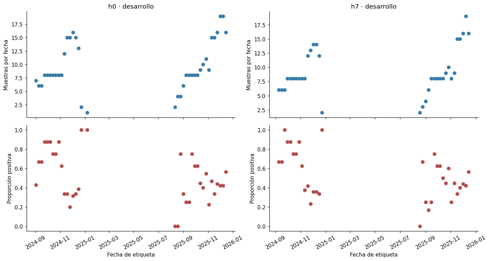

*Cobertura temporal y frecuencia de positivos. Resultados oficiales del notebook académico.*

<table border="1" class="dataframe">
  <thead>
    <tr style="text-align: right;">
      <th>horizonte</th>
      <th>fechas_observadas</th>
      <th>mediana_intervalo_días</th>
      <th>máximo_intervalo_días</th>
    </tr>
  </thead>
  <tbody>
    <tr>
      <td>0</td>
      <td>37</td>
      <td>7.000</td>
      <td>217.000</td>
    </tr>
    <tr>
      <td>7</td>
      <td>34</td>
      <td>7.000</td>
      <td>238.000</td>
    </tr>
  </tbody>
</table>

La cobertura presenta un intervalo prolongado entre campañas y tamaños variables por fecha. Las proporciones extremas pueden surgir de pocas muestras y no representan prevalencia regional. Los folds semanales aprobados evitan atravesar ese intervalo dentro de un bloque de validación, aunque el primer entrenamiento pertenece principalmente a la campaña anterior.

### 3.10 Cobertura por ubicación

Asignamos códigos U01, U02, … solo para visualizar la cobertura, sin mostrar la correspondencia con coordenadas o IDs de origen. Contamos una muestra por horizonte y fecha, usando una sola ventana. Estos códigos no entran al modelo.

<table border="1" class="dataframe">
  <thead>
    <tr style="text-align: right;">
      <th>ubicación</th>
      <th>n</th>
      <th>positivos</th>
      <th>horizonte</th>
      <th>proporción_positiva</th>
    </tr>
  </thead>
  <tbody>
    <tr>
      <td>U01</td>
      <td>31</td>
      <td>12</td>
      <td>0</td>
      <td>0.387</td>
    </tr>
    <tr>
      <td>U02</td>
      <td>7</td>
      <td>1</td>
      <td>0</td>
      <td>0.143</td>
    </tr>
    <tr>
      <td>U03</td>
      <td>34</td>
      <td>20</td>
      <td>0</td>
      <td>0.588</td>
    </tr>
    <tr>
      <td>U04</td>
      <td>10</td>
      <td>3</td>
      <td>0</td>
      <td>0.300</td>
    </tr>
    <tr>
      <td>U05</td>
      <td>12</td>
      <td>5</td>
      <td>0</td>
      <td>0.417</td>
    </tr>
    <tr>
      <td>U06</td>
      <td>5</td>
      <td>2</td>
      <td>0</td>
      <td>0.400</td>
    </tr>
    <tr>
      <td>U07</td>
      <td>14</td>
      <td>3</td>
      <td>0</td>
      <td>0.214</td>
    </tr>
    <tr>
      <td>U08</td>
      <td>28</td>
      <td>16</td>
      <td>0</td>
      <td>0.571</td>
    </tr>
    <tr>
      <td>U09</td>
      <td>9</td>
      <td>2</td>
      <td>0</td>
      <td>0.222</td>
    </tr>
    <tr>
      <td>U10</td>
      <td>3</td>
      <td>3</td>
      <td>0</td>
      <td>1.000</td>
    </tr>
    <tr>
      <td>U11</td>
      <td>6</td>
      <td>0</td>
      <td>0</td>
      <td>0.000</td>
    </tr>
    <tr>
      <td>U12</td>
      <td>33</td>
      <td>26</td>
      <td>0</td>
      <td>0.788</td>
    </tr>
    <tr>
      <td>U13</td>
      <td>4</td>
      <td>3</td>
      <td>0</td>
      <td>0.750</td>
    </tr>
    <tr>
      <td>U14</td>
      <td>5</td>
      <td>0</td>
      <td>0</td>
      <td>0.000</td>
    </tr>
    <tr>
      <td>U15</td>
      <td>12</td>
      <td>5</td>
      <td>0</td>
      <td>0.417</td>
    </tr>
    <tr>
      <td>U16</td>
      <td>35</td>
      <td>22</td>
      <td>0</td>
      <td>0.629</td>
    </tr>
    <tr>
      <td>U17</td>
      <td>31</td>
      <td>16</td>
      <td>0</td>
      <td>0.516</td>
    </tr>
    <tr>
      <td>U18</td>
      <td>4</td>
      <td>0</td>
      <td>0</td>
      <td>0.000</td>
    </tr>
    <tr>
      <td>U19</td>
      <td>8</td>
      <td>0</td>
      <td>0</td>
      <td>0.000</td>
    </tr>
    <tr>
      <td>U20</td>
      <td>9</td>
      <td>0</td>
      <td>0</td>
      <td>0.000</td>
    </tr>
    <tr>
      <td>U21</td>
      <td>31</td>
      <td>25</td>
      <td>0</td>
      <td>0.806</td>
    </tr>
    <tr>
      <td>U22</td>
      <td>28</td>
      <td>7</td>
      <td>0</td>
      <td>0.250</td>
    </tr>
    <tr>
      <td>U01</td>
      <td>29</td>
      <td>12</td>
      <td>7</td>
      <td>0.414</td>
    </tr>
    <tr>
      <td>U02</td>
      <td>6</td>
      <td>1</td>
      <td>7</td>
      <td>0.167</td>
    </tr>
    <tr>
      <td>U03</td>
      <td>30</td>
      <td>18</td>
      <td>7</td>
      <td>0.600</td>
    </tr>
    <tr>
      <td>U04</td>
      <td>8</td>
      <td>2</td>
      <td>7</td>
      <td>0.250</td>
    </tr>
    <tr>
      <td>U05</td>
      <td>10</td>
      <td>5</td>
      <td>7</td>
      <td>0.500</td>
    </tr>
    <tr>
      <td>U06</td>
      <td>4</td>
      <td>1</td>
      <td>7</td>
      <td>0.250</td>
    </tr>
    <tr>
      <td>U07</td>
      <td>10</td>
      <td>2</td>
      <td>7</td>
      <td>0.200</td>
    </tr>
    <tr>
      <td>U08</td>
      <td>23</td>
      <td>14</td>
      <td>7</td>
      <td>0.609</td>
    </tr>
    <tr>
      <td>U09</td>
      <td>8</td>
      <td>2</td>
      <td>7</td>
      <td>0.250</td>
    </tr>
    <tr>
      <td>U10</td>
      <td>2</td>
      <td>2</td>
      <td>7</td>
      <td>1.000</td>
    </tr>
    <tr>
      <td>U11</td>
      <td>5</td>
      <td>0</td>
      <td>7</td>
      <td>0.000</td>
    </tr>
    <tr>
      <td>U12</td>
      <td>31</td>
      <td>24</td>
      <td>7</td>
      <td>0.774</td>
    </tr>
    <tr>
      <td>U13</td>
      <td>3</td>
      <td>2</td>
      <td>7</td>
      <td>0.667</td>
    </tr>
    <tr>
      <td>U14</td>
      <td>4</td>
      <td>0</td>
      <td>7</td>
      <td>0.000</td>
    </tr>
    <tr>
      <td>U15</td>
      <td>10</td>
      <td>4</td>
      <td>7</td>
      <td>0.400</td>
    </tr>
    <tr>
      <td>U16</td>
      <td>33</td>
      <td>21</td>
      <td>7</td>
      <td>0.636</td>
    </tr>
    <tr>
      <td>U17</td>
      <td>29</td>
      <td>16</td>
      <td>7</td>
      <td>0.552</td>
    </tr>
    <tr>
      <td>U18</td>
      <td>3</td>
      <td>0</td>
      <td>7</td>
      <td>0.000</td>
    </tr>
    <tr>
      <td>U19</td>
      <td>6</td>
      <td>0</td>
      <td>7</td>
      <td>0.000</td>
    </tr>
    <tr>
      <td>U20</td>
      <td>7</td>
      <td>0</td>
      <td>7</td>
      <td>0.000</td>
    </tr>
    <tr>
      <td>U21</td>
      <td>27</td>
      <td>23</td>
      <td>7</td>
      <td>0.852</td>
    </tr>
    <tr>
      <td>U22</td>
      <td>25</td>
      <td>7</td>
      <td>7</td>
      <td>0.280</td>
    </tr>
  </tbody>
</table>

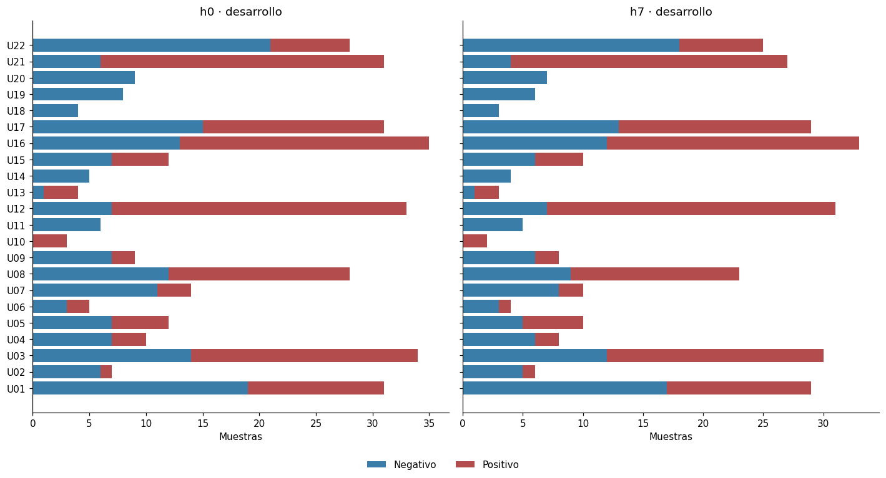

*Cobertura por ubicación. Resultados oficiales del notebook académico.*

La cantidad de registros y el balance de clases varían entre ubicaciones. Los lugares más seguidos aportan más peso al ajuste y a las métricas agregadas. La separación temporal permite repetir ubicaciones entre entrenamiento y validación; por eso los resultados no estiman rendimiento en localidades nunca observadas.

## 4. Metodología

### 4.1 Entrada → salida y modelos

La entrada contiene únicamente los diez resúmenes meteorológicos calculados entre t−w y t−1, con w igual a 7 o 14. La salida es una puntuación para la clase positiva y una clase con umbral **0,5**. En h0 la etiqueta está registrada en t; en h7 está registrada exactamente en t+7. Identificadores, coordenadas, fechas y `resultado_t` no entran en LR/RF.

- **Regresión logística (LR):** `StandardScaler → LogisticRegression`. El escalador se ajusta dentro de cada entrenamiento temporal. C controla la regularización inversa; usamos un máximo de 3.000 iteraciones.
- **Random Forest (RF):** 300 árboles, sin necesidad de escalado. Limitamos profundidad y mínimo por hoja según la grilla aprobada.
- **Mayoría:** se calcula con las etiquetas de cada entrenamiento; en empate predice negativo. Su puntuación constante es la proporción positiva de entrenamiento.
- **Persistencia h7:** usa el resultado registrado en t como predicción del de t+7. Es una referencia que dispone de información de estado que los modelos meteorológicos no usan. Su disponibilidad operacional tampoco está acreditada.

Mostramos la estructura y los parámetros de los pipelines seleccionados a partir de la configuración congelada, sin cargar ni ajustar modelos.

<table border="1" class="dataframe">
  <thead>
    <tr style="text-align: right;">
      <th>variable</th>
      <th>unidad</th>
    </tr>
  </thead>
  <tbody>
    <tr>
      <td>hr_media_pct</td>
      <td>%</td>
    </tr>
    <tr>
      <td>hr_min_pct</td>
      <td>%</td>
    </tr>
    <tr>
      <td>hr_max_pct</td>
      <td>%</td>
    </tr>
    <tr>
      <td>temperatura_media_c</td>
      <td>°C</td>
    </tr>
    <tr>
      <td>temperatura_min_c</td>
      <td>°C</td>
    </tr>
    <tr>
      <td>temperatura_max_c</td>
      <td>°C</td>
    </tr>
    <tr>
      <td>precipitacion_mm</td>
      <td>mm</td>
    </tr>
    <tr>
      <td>viento_vel_media_10m_ms</td>
      <td>m/s</td>
    </tr>
    <tr>
      <td>viento_u_media_10m_ms</td>
      <td>m/s</td>
    </tr>
    <tr>
      <td>viento_v_media_10m_ms</td>
      <td>m/s</td>
    </tr>
  </tbody>
</table>

<table border="1" class="dataframe">
  <thead>
    <tr style="text-align: right;">
      <th>config</th>
      <th>pipeline</th>
      <th>parametros</th>
    </tr>
  </thead>
  <tbody>
    <tr>
      <td>RF_7d_h0</td>
      <td>RandomForestClassifier (300 árboles)</td>
      <td>{'model__max_depth': 3, 'model__min_samples_le...</td>
    </tr>
    <tr>
      <td>LR_14d_h7</td>
      <td>StandardScaler → LogisticRegression</td>
      <td>{'model__C': 10}</td>
    </tr>
  </tbody>
</table>

El contrato de entrada es el mismo para todos los modelos: diez variables y el mismo orden. Cambian horizonte, ventana y algoritmo. Persistencia ayuda a evaluar si el clima agrega valor frente a mantener el estado conocido, pero no equivale a una alerta agronómica validada.

### 4.2 Validación temporal e hiperparámetros

Usamos tres folds crecientes, cada uno con seis fechas semanales de etiqueta, y purga de 14 días respecto de la primera referencia validada. Para h7 la etiqueta futura de entrenamiento también debe respetar esa separación. Los entrenamientos/validaciones son 164/38, 188/55 y 239/100 en h0; 141/31, 150/51 y 196/90 en h7.

GridSearchCV optimizó F1 de positivos en esos folds. Semilla 42, umbral 0,5 y grillas fijas. Las tres medias de CV son descriptivas y sus bloques no son experimentos independientes. La búsqueda y selección sobre los mismos folds pueden hacer optimista el resultado de validación; no es validación anidada.

<table border="1" class="dataframe">
  <thead>
    <tr style="text-align: right;">
      <th>horizonte</th>
      <th>bloque</th>
      <th>n</th>
      <th>negativos</th>
      <th>positivos</th>
      <th>ubicaciones</th>
      <th>etiqueta_inicio</th>
      <th>etiqueta_fin</th>
    </tr>
  </thead>
  <tbody>
    <tr>
      <td>0</td>
      <td>1</td>
      <td>38</td>
      <td>23.0</td>
      <td>15.0</td>
      <td>8.0</td>
      <td>2025-08-18</td>
      <td>2025-09-22</td>
    </tr>
    <tr>
      <td>0</td>
      <td>2</td>
      <td>55</td>
      <td>29.0</td>
      <td>26.0</td>
      <td>12.0</td>
      <td>2025-09-29</td>
      <td>2025-11-03</td>
    </tr>
    <tr>
      <td>0</td>
      <td>3</td>
      <td>100</td>
      <td>56.0</td>
      <td>44.0</td>
      <td>19.0</td>
      <td>2025-11-10</td>
      <td>2025-12-15</td>
    </tr>
    <tr>
      <td>7</td>
      <td>1</td>
      <td>31</td>
      <td>19.0</td>
      <td>12.0</td>
      <td>8.0</td>
      <td>2025-08-18</td>
      <td>2025-09-22</td>
    </tr>
    <tr>
      <td>7</td>
      <td>2</td>
      <td>51</td>
      <td>25.0</td>
      <td>26.0</td>
      <td>11.0</td>
      <td>2025-09-29</td>
      <td>2025-11-03</td>
    </tr>
    <tr>
      <td>7</td>
      <td>3</td>
      <td>90</td>
      <td>51.0</td>
      <td>39.0</td>
      <td>19.0</td>
      <td>2025-11-10</td>
      <td>2025-12-15</td>
    </tr>
  </tbody>
</table>

<table border="1" class="dataframe">
  <thead>
    <tr style="text-align: right;">
      <th>modelo</th>
      <th>parámetro</th>
      <th>valores</th>
    </tr>
  </thead>
  <tbody>
    <tr>
      <td>LR</td>
      <td>C</td>
      <td>[0.1, 1, 10]</td>
    </tr>
    <tr>
      <td>RF</td>
      <td>n_estimators</td>
      <td>300</td>
    </tr>
    <tr>
      <td>RF</td>
      <td>max_depth</td>
      <td>[3, 5, None]</td>
    </tr>
    <tr>
      <td>RF</td>
      <td>min_samples_leaf</td>
      <td>[3, 5, 10]</td>
    </tr>
    <tr>
      <td>Ambos</td>
      <td>semilla</td>
      <td>42</td>
    </tr>
    <tr>
      <td>Ambos</td>
      <td>umbral</td>
      <td>0.5</td>
    </tr>
  </tbody>
</table>

Cada bloque abarca 35 días transcurridos y 36 incluyendo los extremos, con seis observaciones semanales de fecha. El primer fold prueba transferencia desde la campaña anterior. No confundimos la purga con una prueba de disponibilidad operacional: no contamos con fechas de publicación verificadas para todas las etiquetas.

### 4.3 Resultados de validación y selección congelada

Seleccionamos por **F1 medio de positivos**. Ante empate a tres decimales, preferimos 7 días y luego LR; todas las configuraciones tienen diez variables. El F1 combina precisión y recall, pero no refleja por sí solo el costo agronómico de omitir un positivo. Mostramos también cada fold y la variabilidad entre bloques.

<table border="1" class="dataframe">
  <thead>
    <tr style="text-align: right;">
      <th>config</th>
      <th>horizonte</th>
      <th>ventana</th>
      <th>parametros</th>
      <th>cv_f1</th>
      <th>cv_std</th>
      <th>seleccionado</th>
    </tr>
  </thead>
  <tbody>
    <tr>
      <td>LR_7d_h0</td>
      <td>0</td>
      <td>7</td>
      <td>{'model__C': 0.1}</td>
      <td>0.602</td>
      <td>0.072</td>
      <td>False</td>
    </tr>
    <tr>
      <td>RF_7d_h0</td>
      <td>0</td>
      <td>7</td>
      <td>{'model__max_depth': 3, 'model__min_samples_le...</td>
      <td>0.629</td>
      <td>0.102</td>
      <td>True</td>
    </tr>
    <tr>
      <td>LR_14d_h0</td>
      <td>0</td>
      <td>14</td>
      <td>{'model__C': 10}</td>
      <td>0.622</td>
      <td>0.026</td>
      <td>False</td>
    </tr>
    <tr>
      <td>RF_14d_h0</td>
      <td>0</td>
      <td>14</td>
      <td>{'model__max_depth': 5, 'model__min_samples_le...</td>
      <td>0.616</td>
      <td>0.057</td>
      <td>False</td>
    </tr>
    <tr>
      <td>LR_7d_h7</td>
      <td>7</td>
      <td>7</td>
      <td>{'model__C': 1}</td>
      <td>0.574</td>
      <td>0.083</td>
      <td>False</td>
    </tr>
    <tr>
      <td>RF_7d_h7</td>
      <td>7</td>
      <td>7</td>
      <td>{'model__max_depth': None, 'model__min_samples...</td>
      <td>0.597</td>
      <td>0.096</td>
      <td>False</td>
    </tr>
    <tr>
      <td>LR_14d_h7</td>
      <td>7</td>
      <td>14</td>
      <td>{'model__C': 10}</td>
      <td>0.631</td>
      <td>0.054</td>
      <td>True</td>
    </tr>
    <tr>
      <td>RF_14d_h7</td>
      <td>7</td>
      <td>14</td>
      <td>{'model__max_depth': None, 'model__min_samples...</td>
      <td>0.614</td>
      <td>0.066</td>
      <td>False</td>
    </tr>
  </tbody>
</table>

<table border="1" class="dataframe">
  <thead>
    <tr style="text-align: right;">
      <th>fold</th>
      <th>1</th>
      <th>2</th>
      <th>3</th>
    </tr>
    <tr>
      <th>config</th>
      <th></th>
      <th></th>
      <th></th>
    </tr>
  </thead>
  <tbody>
    <tr>
      <th>LR_14d_h0</th>
      <td>0.5854</td>
      <td>0.6462</td>
      <td>0.6337</td>
    </tr>
    <tr>
      <th>LR_14d_h7</th>
      <td>0.5946</td>
      <td>0.7077</td>
      <td>0.5913</td>
    </tr>
    <tr>
      <th>LR_7d_h0</th>
      <td>0.6047</td>
      <td>0.6885</td>
      <td>0.5116</td>
    </tr>
    <tr>
      <th>LR_7d_h7</th>
      <td>0.4865</td>
      <td>0.6857</td>
      <td>0.5510</td>
    </tr>
    <tr>
      <th>RF_14d_h0</th>
      <td>0.5405</td>
      <td>0.6774</td>
      <td>0.6296</td>
    </tr>
    <tr>
      <th>RF_14d_h7</th>
      <td>0.6061</td>
      <td>0.6984</td>
      <td>0.5385</td>
    </tr>
    <tr>
      <th>RF_7d_h0</th>
      <td>0.7000</td>
      <td>0.7018</td>
      <td>0.4848</td>
    </tr>
    <tr>
      <th>RF_7d_h7</th>
      <td>0.5714</td>
      <td>0.7246</td>
      <td>0.4946</td>
    </tr>
    <tr>
      <th>mayoria_h0</th>
      <td>0.5660</td>
      <td>0.0000</td>
      <td>0.0000</td>
    </tr>
    <tr>
      <th>mayoria_h7</th>
      <td>0.5581</td>
      <td>0.6753</td>
      <td>0.6047</td>
    </tr>
    <tr>
      <th>persistencia_h7</th>
      <td>0.1905</td>
      <td>0.8302</td>
      <td>0.5333</td>
    </tr>
  </tbody>
</table>

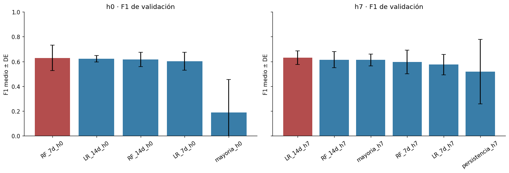

*Resultados de validación y selección congelada. Resultados oficiales del notebook académico.*

La selección aprobada es **RF de 7 días para h0** (F1 medio ≈0,629; profundidad 3 y mínimo 10 por hoja) y **LR de 14 días para h7** (F1 medio ≈0,631; C=10). Las barras de dispersión son desviaciones estándar descriptivas de tres folds, no intervalos de confianza. Estos modelos se mantienen aunque otro obtenga una cifra histórica más favorable.

## 5. Resultados y discusión

### 5.1 Comparación histórica de las ocho configuraciones y referencias

El período histórico contiene 66 muestras h0 (29 negativas y 37 positivas) y 46 h7 (22 negativas y 24 positivas). Mostramos todas las configuraciones para hacer transparente el experimento; **no elegimos una nueva ganadora a partir de esta tabla**. H0 y h7 no comparten exactamente población ni tarea.

Precisión, recall y F1 corresponden a la clase positiva; ROC AUC evalúa ordenación y average precision (AP) resume la curva de precisión–recall. Ninguna métrica demuestra calibración probabilística. La accuracy puede ocultar fallos de la clase positiva.

<table border="1" class="dataframe">
  <thead>
    <tr style="text-align: right;">
      <th>config</th>
      <th>seleccionado</th>
      <th>cv_f1</th>
      <th>historico_f1</th>
      <th>historico_precision</th>
      <th>historico_recall</th>
      <th>historico_roc_auc</th>
    </tr>
  </thead>
  <tbody>
    <tr>
      <td>mayoria_h0</td>
      <td>False</td>
      <td>0.189</td>
      <td>0.000</td>
      <td>0.000</td>
      <td>0.000</td>
      <td>0.500</td>
    </tr>
    <tr>
      <td>LR_7d_h0</td>
      <td>False</td>
      <td>0.602</td>
      <td>0.327</td>
      <td>0.667</td>
      <td>0.216</td>
      <td>0.661</td>
    </tr>
    <tr>
      <td>RF_7d_h0</td>
      <td>True</td>
      <td>0.629</td>
      <td>0.385</td>
      <td>0.667</td>
      <td>0.270</td>
      <td>0.649</td>
    </tr>
    <tr>
      <td>LR_14d_h0</td>
      <td>False</td>
      <td>0.622</td>
      <td>0.377</td>
      <td>0.625</td>
      <td>0.270</td>
      <td>0.565</td>
    </tr>
    <tr>
      <td>RF_14d_h0</td>
      <td>False</td>
      <td>0.616</td>
      <td>0.320</td>
      <td>0.615</td>
      <td>0.216</td>
      <td>0.715</td>
    </tr>
    <tr>
      <td>mayoria_h7</td>
      <td>False</td>
      <td>0.613</td>
      <td>0.000</td>
      <td>0.000</td>
      <td>0.000</td>
      <td>0.500</td>
    </tr>
    <tr>
      <td>persistencia_h7</td>
      <td>False</td>
      <td>0.518</td>
      <td>0.735</td>
      <td>0.720</td>
      <td>0.750</td>
      <td>0.716</td>
    </tr>
    <tr>
      <td>LR_7d_h7</td>
      <td>False</td>
      <td>0.574</td>
      <td>0.444</td>
      <td>0.667</td>
      <td>0.333</td>
      <td>0.489</td>
    </tr>
    <tr>
      <td>RF_7d_h7</td>
      <td>False</td>
      <td>0.597</td>
      <td>0.444</td>
      <td>0.667</td>
      <td>0.333</td>
      <td>0.574</td>
    </tr>
    <tr>
      <td>LR_14d_h7</td>
      <td>True</td>
      <td>0.631</td>
      <td>0.485</td>
      <td>0.889</td>
      <td>0.333</td>
      <td>0.464</td>
    </tr>
    <tr>
      <td>RF_14d_h7</td>
      <td>False</td>
      <td>0.614</td>
      <td>0.343</td>
      <td>0.545</td>
      <td>0.250</td>
      <td>0.636</td>
    </tr>
  </tbody>
</table>

<table border="1" class="dataframe">
  <thead>
    <tr style="text-align: right;">
      <th>config</th>
      <th>historico_tn</th>
      <th>historico_fp</th>
      <th>historico_fn</th>
      <th>historico_tp</th>
    </tr>
  </thead>
  <tbody>
    <tr>
      <td>LR_14d_h7</td>
      <td>21</td>
      <td>1</td>
      <td>16</td>
      <td>8</td>
    </tr>
    <tr>
      <td>RF_7d_h0</td>
      <td>24</td>
      <td>5</td>
      <td>27</td>
      <td>10</td>
    </tr>
  </tbody>
</table>

El RF seleccionado para h0 alcanza F1 ≈0,385 y detecta 10 de 37 positivos (recall ≈0,270). La LR seleccionada para h7 alcanza F1 ≈0,485 y detecta 8 de 24 (recall ≈0,333), con precisión ≈0,889. Esa precisión se obtiene identificando pocos positivos: no compensa automáticamente el elevado número de omisiones. La caída respecto de CV limita la evidencia de generalización temporal.

### 5.2 Matrices de confusión

Dibujamos los conteos de las ocho configuraciones y las referencias. Filas: clase real. Columnas: clase predicha. Los títulos indican la selección congelada. Mantener los conteos permite reconocer el tamaño pequeño de cada evaluación.

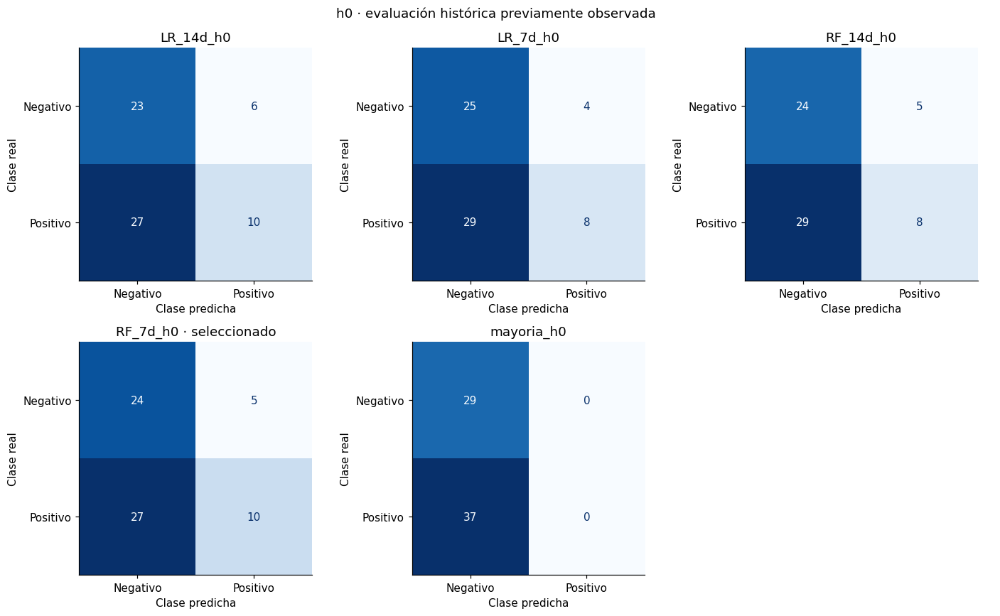

*Matrices de confusión. Resultados oficiales del notebook académico.*

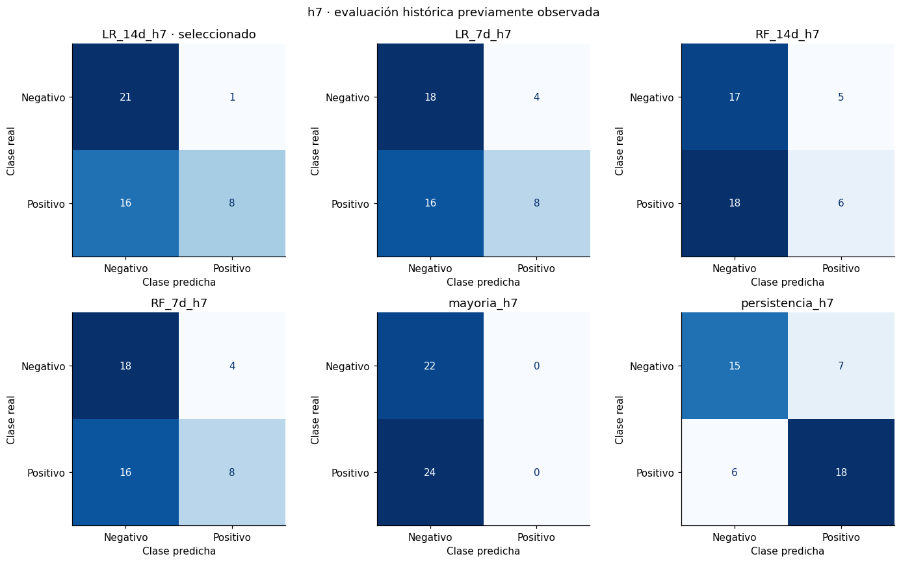

*Matrices de confusión. Resultados oficiales del notebook académico.*

Los modelos seleccionados omiten 27 positivos en h0 y 16 en h7. La mayoría no predice positivos en estos entrenamientos históricos y, por tanto, su F1 positivo es cero. En h7, persistencia detecta 18 de los 24 positivos; su matriz aporta un contraste más exigente que la mayoría para esta tarea.

### 5.3 Curvas ROC y Precision–Recall

Usamos las coordenadas de curvas exportadas desde las puntuaciones históricas oficiales, sin modificar el umbral 0,5. Mostramos todas las configuraciones y referencias por horizonte. La diagonal de ROC representa ordenación aleatoria; la línea horizontal de PR representa la proporción positiva observada del bloque. No ajustamos umbrales a partir de estas curvas.

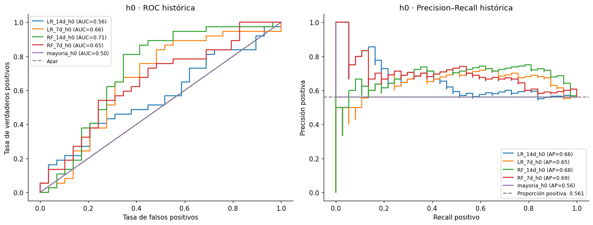

*Curvas ROC y Precision–Recall. Resultados oficiales del notebook académico.*

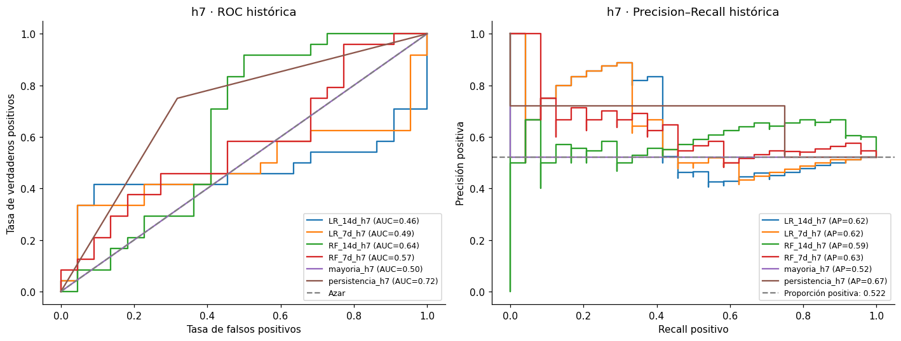

*Curvas ROC y Precision–Recall. Resultados oficiales del notebook académico.*

Las curvas son escalonadas porque los conjuntos históricos son pequeños. AP y ROC AUC resumen aspectos distintos: una precisión elevada en el umbral elegido puede coexistir con una ordenación global débil. Por ejemplo, la LR seleccionada para h7 tiene ROC AUC ≈0,464 pese a su precisión ≈0,889 en 0,5. No interpretamos sus puntuaciones como probabilidades agronómicas calibradas.

### 5.4 Curvas de aprendizaje temporal

Leemos las curvas guardadas de la Etapa D. En cada fold se ajustaron prefijos temporales del 40 %, 70 % y 100 % de sus fechas de entrenamiento, manteniendo la validación del fold. No se hicieron subconjuntos aleatorios. Mostramos medias y desviaciones entre folds, junto con los tamaños efectivos; la fracción se refiere a fechas y no a igual cantidad de filas.

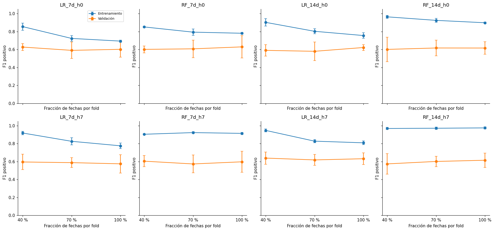

*Curvas de aprendizaje temporal. Resultados oficiales del notebook académico.*

El rendimiento de entrenamiento supera al de validación en las ocho configuraciones al utilizar el entrenamiento completo. Algunas RF muestran brechas amplias, compatibles con sobreajuste y diferencias temporales de distribución, sin que la curva identifique una causa única. Las curvas no crecen de manera uniforme al agregar fechas. Sus barras son dispersión entre folds, no incertidumbre de una nueva campaña; tampoco justifican retocar parámetros después de ver el histórico.

### 5.5 Ventanas y referencias

Leemos las diferencias descriptivas aprobadas. Un delta positivo de 14d−7d indica mayor F1 con la ventana larga para ese algoritmo y horizonte, sin constituir una prueba de significación. En h7 contrastamos además contra mantener el resultado registrado en t.

<table border="1" class="dataframe">
  <thead>
    <tr style="text-align: right;">
      <th>horizonte</th>
      <th>modelo</th>
      <th>comparacion</th>
      <th>delta_cv_f1</th>
      <th>delta_historico_f1</th>
    </tr>
  </thead>
  <tbody>
    <tr>
      <td>0</td>
      <td>LR</td>
      <td>14d menos 7d</td>
      <td>0.020</td>
      <td>0.051</td>
    </tr>
    <tr>
      <td>0</td>
      <td>RF</td>
      <td>14d menos 7d</td>
      <td>-0.013</td>
      <td>-0.065</td>
    </tr>
    <tr>
      <td>7</td>
      <td>LR</td>
      <td>14d menos 7d</td>
      <td>0.057</td>
      <td>0.040</td>
    </tr>
    <tr>
      <td>7</td>
      <td>RF</td>
      <td>14d menos 7d</td>
      <td>0.017</td>
      <td>-0.102</td>
    </tr>
  </tbody>
</table>

<table border="1" class="dataframe">
  <thead>
    <tr style="text-align: right;">
      <th>config</th>
      <th>cv_f1</th>
      <th>historico_f1</th>
      <th>historico_precision</th>
      <th>historico_recall</th>
    </tr>
  </thead>
  <tbody>
    <tr>
      <td>mayoria_h0</td>
      <td>0.189</td>
      <td>0.000</td>
      <td>0.000</td>
      <td>0.000</td>
    </tr>
    <tr>
      <td>mayoria_h7</td>
      <td>0.613</td>
      <td>0.000</td>
      <td>0.000</td>
      <td>0.000</td>
    </tr>
    <tr>
      <td>persistencia_h7</td>
      <td>0.518</td>
      <td>0.735</td>
      <td>0.720</td>
      <td>0.750</td>
    </tr>
  </tbody>
</table>

### 5.6 Matrices normalizadas

Cada fila suma uno y expresa qué proporción de cada clase real se clasifica correctamente. La normalización facilita comparar clases de diferente tamaño; los conteos anteriores conservan el tamaño efectivo del histórico.

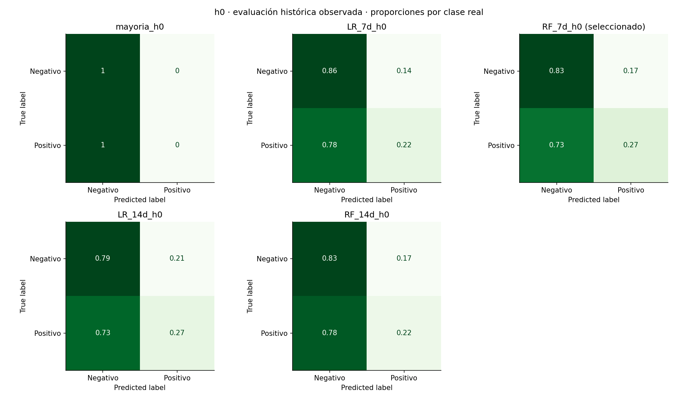

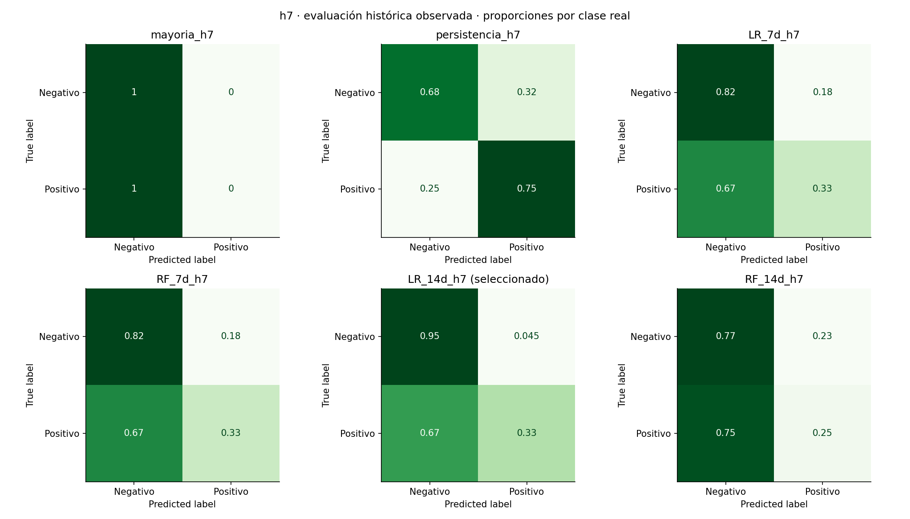

## 6. Conclusiones y referencias

En CV, 14 días mejora LR en ambos horizontes y RF en h7; no mejora RF en h0. En la evaluación histórica, las RF de 14 días empeoran frente a sus versiones de 7 días, mientras LR mejora moderadamente. Por eso no hay una ventaja uniforme de ampliar la ventana.

Persistencia h7 alcanza F1 ≈0,735 y recall 0,75 en el histórico, superiores a los de la LR seleccionada. Esta comparación limita la evidencia de valor adicional de los resúmenes climáticos frente a conocer el estado actual. No sustituimos el modelo seleccionado ni cambiamos el experimento después de observar ese resultado.

### 6.1 Discusión y conclusiones

1. La validación seleccionó RF de 7 días para h0 y LR de 14 días para h7. Conservamos esa selección y sus parámetros.
2. Los modelos seleccionados muestran recall histórico bajo. Estos resultados no respaldan una alerta agronómica ni una recomendación de manejo.
3. H0 clasifica un estado registrado actual. H7 predice experimentalmente el estado registrado siete días después e incluye positivos previos; no identifica exclusivamente nuevas infecciones o primeras detecciones.
4. `fecha_registro` coincide con `primera_consulta`; no se confirmó fecha de muestreo ni disponibilidad de todas las etiquetas al emitir una predicción. ERA5 es retrospectivo. La ausencia técnica de solapamiento no resuelve esa limitación operacional.
5. Las ubicaciones se repiten, la cobertura es desigual y algunas comparten coordenadas o celdas meteorológicas. La prueba temporal no acredita transferencia geográfica. Los horizontes tienen poblaciones diferentes y el histórico es pequeño y previamente observado.
6. Las puntuaciones no están validadas como probabilidades calibradas de aparición de roya. Las asociaciones meteorológicas no demuestran causalidad.

Una futura evaluación prospectiva necesitaría fechas de muestreo y publicación verificadas, protocolo de confirmación de etiquetas y datos realmente inéditos, reservados antes de analizarlos. Este trabajo mantiene el alcance retrospectivo aprobado y no realiza ajustes nuevos a partir de la evaluación histórica.

### 6.2 Bibliografía

Pedregosa, F. et al. (2011). Scikit-learn: Machine Learning in Python. *Journal of Machine Learning Research*, 12, 2825–2830. https://jmlr.org/papers/v12/pedregosa11a.html

Hersbach, H. et al. (2020). The ERA5 global reanalysis. *Quarterly Journal of the Royal Meteorological Society*, 146, 1999–2049. https://doi.org/10.1002/qj.3803

Del Ponte, E. M. y Esker, P. D. (2008). Meteorological factors and Asian soybean rust epidemics: a systems approach and implications for risk assessment. *Scientia Agricola*, 65, 88–97. [Artículo](https://www.scielo.br/j/sa/a/DnFFn5X4cLyTZyKLHQ4YbLt/?lang=en).

Melching, J. S. et al. (1989). Effects of duration, frequency, and temperature of leaf wetness periods on soybean rust. *Plant Disease*, 73, 117–122. [Artículo original](https://www.apsnet.org/publications/PlantDisease/BackIssues/Documents/1989Articles/PlantDisease73n02_117.PDF).